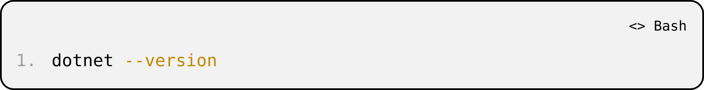
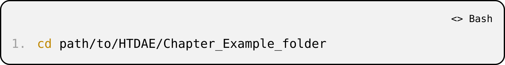
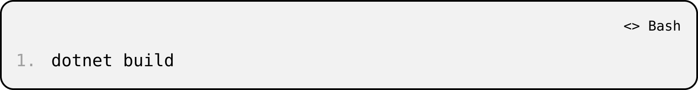
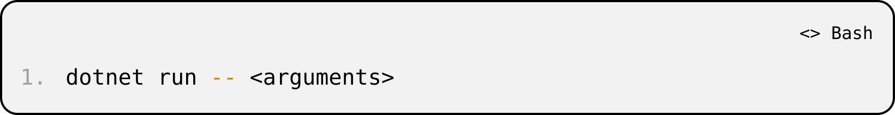
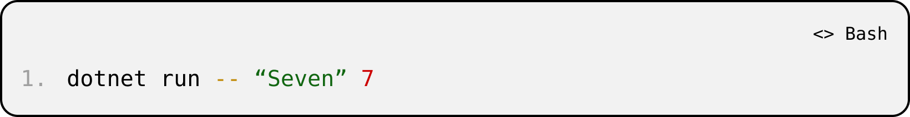
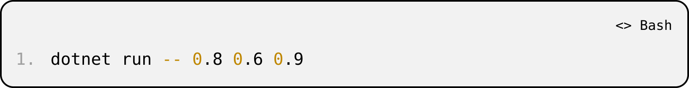
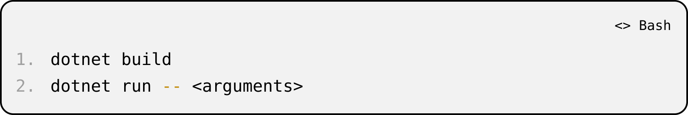
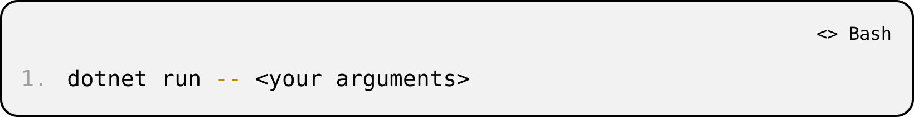

# How to Run the Code Examples in This Book

This book includes executable C# examples for key architectural demonstrations. Each example appears in its own dedicated folder and includes:

- A .csproj project file
- One or more .cs source files
- A README.md file explaining how to run that specific example

All example folders follow the same structure and execution pattern.

## Download the Code

Download the complete code archive here:

[Book Code Download (ZIP)](https://github.com/The-John-Charitable-Trust/how-to-design-an-emotion/raw/main/code/how-to-design-an-emotion-code.zip)

You can also browse the code online in the [`code/` folder](../../code/) of this repository.

After downloading:

- Extract the .zip file.
- You will see separate folders for each chapter example.
- Each folder is self-contained and runnable.

## System Requirements

To run the code, you will need:

### 1. A Supported Operating System

- Windows
- macOS
- Linux

### 2. The .NET SDK (Latest Stable Version)

Download and install from:

<https://dotnet.microsoft.com/download>

After installation, verify it by opening a terminal and running:

If a version number appears, installation succeeded.

### 3. Visual Studio Code (Recommended)

Download VS Code here:

<https://code.visualstudio.com/>

After installation:

- Open VS Code
- Install the official C# extension (recommended for syntax highlighting, IntelliSense, and debugging)

VS Code is not strictly required. You can run everything from a terminal. However, it provides a cleaner development experience.

## Standard Workflow for Every Example Folder

Each example follows the same pattern.

### Step 1 — Open a Terminal in the Example Folder (Command Prompt or PowerShell on Windows, Terminal on macOS/Linux)

Navigate to the folder containing the .csproj file.

Example:

### Step 2 — Build the Project

This step compiles the project and ensures all dependencies are resolved. In most cases, dotnet run will perform this automatically.

### Step 3 — Run the Program with Parameters

Many examples require runtime input parameters provided at execution time.

Use:

The -- tells .NET that everything following it is passed to the program as input parameters.

Example (Integer Concept):

Example (Core Affect Concept):

Each folder’s README.md lists:

- Required arguments
- Example commands
- Expected output

## Using VS Code

- Open VS Code
- Select File → Open Folder…
- Choose the specific example folder
- Open the integrated terminal (Terminal → New Terminal)
- Run:

## Conceptual Convention Used Throughout the Book

Each example demonstrates a structural distinction:

- Concept → Declared as a class (identity fixed at definition)
- Construct → Instantiated at runtime (values supplied through parameters)
- Output → Confirms what values flowed into the object

The code is not presented as software engineering instruction. It is presented as architectural clarification.

Each chapter folder stands alone so that:

- No cross-dependencies exist between examples
- Readers can test each concept independently
- Execution remains transparent and inspectable

## Troubleshooting

### dotnet not recognized

Reinstall the .NET SDK and reopen your terminal.

### Build fails

Ensure:

- You are inside the folder containing the .csproj
- The SDK version matches or exceeds the target framework version in the .csproj

### Arguments not reaching the program

Always place runtime parameters after --:

