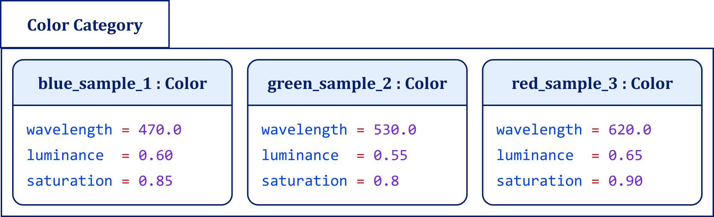
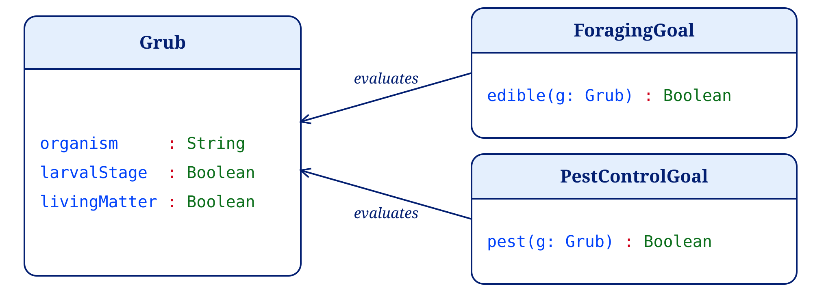
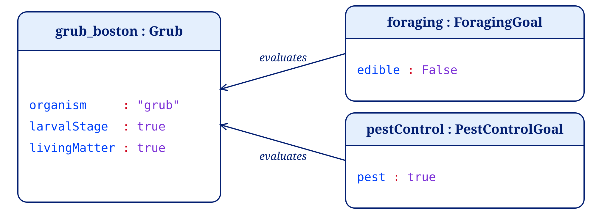

# Chapter 4: The Misappropriation of the Concept

*The Orphaning of Identity Conditions*

*Chapter 3 argued that identity conditions ought to survive the rejection of fixed essences. Chapter 4 examines what follows when theories fail to preserve that distinction.*

*Modern theories rightly reject the classical assumption that concepts derive their identity from fixed essences. Emotion does not come stamped with one neural signature, one bodily pattern, or one universal expression. Concepts do not exist as fixed inner essences awaiting application. Lisa Feldman Barrett (b. 1963), Eleanor Rosch, George Lakoff (b. 1941), Lawrence Barsalou, Andy Clark (b. 1957), and Karl J. Friston (b. 1959) all contribute to dismantling that assumption.*

*Rejecting fixed essences, however, does not by itself explain what secures identity conditions.*

*This chapter exposes that architectural error: downstream operations assume upstream authority. They borrow the explanatory work of identity conditions while denying the need for them.*

*The repair is simple but fundamental: restore each explanatory level to its proper place.*

*Concept constrains. Instance realizes. Category groups.*

*A concept specifies admissibility conditions. An instance either satisfies or violates those conditions. A category groups admissible instances. Goals then regulate those groupings. Prediction, simulation, learning, culture, and embodiment all contribute to conceptual performance, but they operate within a constraint space. They do not create that space.*

<strong>CHAPTER V</strong>

<strong>Rules vs. Prototypes</strong>

<em>Why the Great Debate Over Concepts Is a Faux Dichotomy</em>

[Notes](../references/notes/chapter-04.md) · [Bibliography](../references/bibliography/chapter-04.md)

Chapter 3 argued that identity conditions ought to survive the rejection of fixed essences. Chapter 4 examines what follows when theories fail to preserve that distinction.

Modern theories rightly reject the classical assumption that concepts derive their identity from fixed essences. Emotion does not come stamped with one neural signature, one bodily pattern, or one universal expression.<a href="../references/notes/chapter-04.md#note-1">1</a> Concepts do not exist as fixed inner essences awaiting application. Lisa Feldman Barrett, Eleanor Rosch, George Lakoff, Lawrence Barsalou, Andy Clark, and Karl J. Friston all contribute to dismantling that assumption.<a href="../references/notes/chapter-04.md#note-2">2</a>

Rejecting fixed essences, however, does not by itself explain what secures identity conditions.

This chapter exposes that architectural error: downstream operations assume upstream authority. They borrow the explanatory work of identity conditions while denying the need for them.<a href="../references/notes/chapter-04.md#note-3">3</a>

The repair is simple but fundamental: restore each explanatory level to its proper place.

Concept constrains. Instance realizes. Category groups.<a href="../references/notes/chapter-04.md#note-4">4</a>

A concept specifies admissibility conditions. An instance either satisfies or violates those conditions. A category groups admissible instances. Goals then regulate those groupings. Prediction, simulation, learning, culture, and embodiment all contribute to conceptual performance, but they operate within a constraint space. They do not create that space.<a href="../references/notes/chapter-04.md#note-5">5</a>

In the previous chapter, I established a critical distinction: identity condition does not naively mean essence. Identity conditions function as architectural constraints. They specify the admissibility conditions under which something can count as an instance.<a href="../references/notes/chapter-04.md#note-6">6</a> I agreed with Lisa Feldman Barrett that emotion theory should reject naive essentialism.<a href="../references/notes/chapter-04.md#note-7">7</a> Emotions do not possess invariant neural signatures, universal biological fingerprints, or a shared set of core features.<a href="../references/notes/chapter-04.md#note-8">8</a> The empirical evidence no longer supports the classical view.<a href="../references/notes/chapter-04.md#note-9">9</a>

Rejecting naive essentialism, however, does not eliminate the need for identity conditions. It relocates the problem. Critics argue that when constructivist theories reject biological essences, they make an emotion’s identity depend on categorization and labeling and give up natural kinds too quickly. On my reading, this happens because they reject essences without reconstructing identity conditions, and so relocate explanatory work toward categorization, prediction, and regulatory success.<a href="../references/notes/chapter-04.md#note-10">10</a> In Barrett's Theory of Constructed Emotion, prediction and categorization do this work: the brain uses past experience to construct a categorization that best fits the situation and guides action.<a href="../references/notes/chapter-04.md#note-11">11</a> For Barrett, a category is a population of instances “treated as similar because they all serve a particular goal in some context,” and emotion categories are “not fixed but … constructed by the brain in an ad hoc, situationally specific manner.” On this reading, identity conditions no longer stand upstream as admissibility constraints for instantiation; what counts as an instance depends on the goal-based function that a situated, predictive construction serves.<a href="../references/notes/chapter-04.md#note-12">12</a>

The failure occurs at a precise architectural point. Theorists mistake partitioning for definition. On theory-based accounts, even children categorize by conceptual knowledge rather than by surface similarity. My own claim is stronger: grouping and discrimination presuppose a concept already in place.<a href="../references/notes/chapter-04.md#note-13">13</a> A color term can group samples as red, but what that property is remains a separate question. A psychological taxonomy can group episodes under anger, fear, or grief, but such labels do not settle what an emotion is. A legal system can classify claims as rights, privileges, powers, or immunities, but the classification alone does not settle which configurations are rights. That question turns on a further account of what rights do.<a href="../references/notes/chapter-04.md#note-14">14</a> Once partitioning substitutes for definition, explanatory order inverts. Downstream operations begin to perform explanatory work that belongs upstream. Stability then reduces to task-relative success.<a href="../references/notes/chapter-04.md#note-15">15</a>

I call this an architectural error because it concerns explanatory priority.<a href="../references/notes/chapter-04.md#note-16">16</a> Some conditions must stand first before later operations can make sense. Identity conditions determine what counts as a possible instance of a concept before any act of grouping, prediction, or categorization.<a href="../references/notes/chapter-04.md#note-17">17</a> Categorization presupposes a domain of admissible instances. Prediction depends on kinds: on a standard criterion, natural kinds are classifications that “permit inductive inferences.”<a href="../references/notes/chapter-04.md#note-18">18</a> Learning depends on projection across cases: as Nelson Goodman (1906–1998) showed with his “grue” paradox, “in order to learn by induction, we need to make a distinction between projectible and non-projectible predicates.” When theorists treat operations that depend upon identity conditions as the source of identity conditions, they reverse the order of explanation.<a href="../references/notes/chapter-04.md#note-19">19</a>

The question, then, does not concern whether categorization and prediction occur. They do. The question concerns where a theory locates identity conditions. Partitioning answers which instances belong together. A concept answers the prior question: what kind of thing exists such that partitioning can occur at all? When theorists collapse that priority, concepts become momentary products of learning, prediction, or cultural grouping.<a href="../references/notes/chapter-04.md#note-20">20</a> The resources required to explain error, disagreement, and sameness across contexts disappear.<a href="../references/notes/chapter-04.md#note-21">21</a>

I resolve this failure by diagnosis rather than rebuttal. I preserve the empirical phenomena that constructionist, prototype, embodied, and predictive accounts rightly emphasize.<a href="../references/notes/chapter-04.md#note-22">22</a> I restore the constraint architecture those phenomena presuppose. I isolate a shared structural misplacement: theorists orphan identity conditions when they push conceptual structure downstream into clustering, categorization, prediction, and learning.<a href="../references/notes/chapter-04.md#note-23">23</a>

On my account, concepts function as constraint structures that fix identity conditions prior to execution. Categorization, prediction, learning, and simulation occur within those constraints. They presuppose identity conditions. They do not generate them.<a href="../references/notes/chapter-04.md#note-24">24</a>

To maintain this distinction, I use UML and object-oriented formalisms to enforce type-instance discipline and expose illicit explanatory shifts.<a href="../references/notes/chapter-04.md#note-25">25</a> These tools do not serve as metaphors for cognition. I use them as formal instruments to prevent equivocation between definition, realization, and grouping.<a href="../references/notes/chapter-04.md#note-26">26</a>

Accordingly, I introduce the repair at a single level: the point at which a theory fixes identity conditions. I do not attempt to correct downstream errors one by one. Once I restore explanatory order, those errors begin to lose their force.<a href="../references/notes/chapter-04.md#note-27">27</a>

I begin with a simple experimental pattern that Barrett references in her account of constructed emotion.<a href="../references/notes/chapter-04.md#note-28">28</a> Researchers show subjects several distorted versions of a visual pattern. The subjects never see the original pattern itself. Later, however, they often recognize or classify the unseen original as if they had inferred it from the distorted examples. This is the dot-pattern paradigm associated with Michael I. Posner (b. 1936) and Steven W. Keele (1940–2005).<a href="../references/notes/chapter-04.md#note-29">29</a>

The case matters because it seems to show that the mind can derive a central pattern from examples without retrieving a fixed intensional definition.<a href="../references/notes/chapter-04.md#note-30">30</a> I accept that lesson. But the experiment also hides a deeper constraint. Subjects can infer a central pattern only because the experiment already supplies a structured representational space within which the examples can vary. The dots can move, but they do not cease to belong to the same task. The mind can infer a central tendency because the experiment has already fixed the underlying space within which variation occurs.<a href="../references/notes/chapter-04.md#note-31">31</a>

<ins>Figure 4-1. Dot-Pattern Distortions and Prototype Abstraction</ins>

<ins>Figure 4-2. Dot-Pattern Central Tendency and Inferred Prototype</ins>

The color-boundary and grub examples I analyze in this chapter come from Lisa Feldman Barrett's cinematic lecture on concepts accompanying How Emotions Are Made.<a href="../references/notes/chapter-04.md#note-32">32</a> In that lecture, she uses the color continuum of a rainbow and cross-cultural food categories (grubs that would prompt a call to an exterminator in Boston might be lunch in Iquitos, Peru) to argue that the brain, in the context of other brains, draws conceptual boundaries rather than finding them.<a href="../references/notes/chapter-04.md#note-33">33</a> She argues that brains “create concepts to categorize sensory inputs and guide action,” and she describes the rainbow as “a continuum of light… without borders” on which “the human brain draws these lines.”<a href="../references/notes/chapter-04.md#note-34">34</a> She also cites the classic Posner and Keele study to argue that a category’s summary representation need not be found in any single instance, and that treating such a summary as the norm is “an essentialist error.”<a href="../references/notes/chapter-04.md#note-35">35</a> In her account of constructed emotion, she cites Posner and Keele as evidence that brains “effortlessly and automatically construct” summary representations that “need not exist in nature.”<a href="../references/notes/chapter-04.md#note-36">36</a>

Subjects can categorize novel stimuli and infer a central tendency without retrieving a canonical mental object.<a href="../references/notes/chapter-04.md#note-37">37</a> But my diagnostic question cuts deeper: does the inferred region reveal categorization behavior, or does it become the concept itself?<a href="../references/notes/chapter-04.md#note-38">38</a>

For a formal constraint reconstruction of Barrett's goal-based concept examples, including fish and car, see [Appendix C: Are Concepts Just Goals?](../appendices/appendix-c.md). That appendix shows how a goal can change which instances matter in a particular context without changing the deeper conditions that make those instances belong to the concept in the first place.

I begin with the dot-diagram case because it exposes the architectural temptation. Posner and Keele report that subjects abstracted a prototype from distorted patterns even when the prototype never appeared during training.<a href="../references/notes/chapter-04.md#note-39">39</a> They also report that the more variable the memorized patterns, the better subjects classified highly distorted new instances, which suggests that information about the schema is abstracted from the stored instances.<a href="../references/notes/chapter-04.md#note-40">40</a> More broadly, the dot-diagram case is compatible with views on which categorization relies on stored experience, whether by abstracting a prototype across instances or by comparing new items with stored exemplars, rather than on a fixed template; I take this to support the constructivist claim.<a href="../references/notes/chapter-04.md#note-41">41</a>

That claim can stand. The error begins only when theorists promote evidence about categorization into a theory of concept identity.<a href="../references/notes/chapter-04.md#note-42">42</a>

[Appendix D](../appendices/appendix-d.md) isolates this same ordering error in the Posner-Keele paradigm and provides a formal reconstruction of it, including its vector-space specification and distance metrics. I introduce that reconstruction not to mathematize cognition, but to make explicit the constraint structure the experiment presupposes.

Here I must be careful. The grid and the dimensions of the dot space constrain which stimuli can appear. They are the experimenter's design, not the subject's concept. In machine learning, a network's architecture can encode an inductive bias, one that leads the learner to prioritize some solutions over others regardless of the data. It does not fix what any learned category means. So the priority I claim is not the priority of a search space.<a href="../references/notes/chapter-04.md#note-43">43</a>

It is the priority of a standard. Typicality ranks members.<a href="../references/notes/chapter-04.md#note-44">44</a> Without admissibility conditions, there are no members to rank. A misclassification is wrong about something. Without admissibility conditions, there is nothing for it to be wrong about. A prediction can fail, but failure is not error unless something fixes what the prediction was supposed to be about. The Posner-Keele subjects did not merely drift toward a centroid. They classified each pattern into one of the categories the experimenter had built from different prototypes, and their classifications could be scored against those categories. Remove the definition, and the experiment cannot even be scored. That is what upstream means. It is a claim about what correctness requires, not about the order in which a brain computes.<a href="../references/notes/chapter-04.md#note-45">45</a>

I therefore begin the diagnostic sequence with the foundational error: treating partitioning as concept formation. Clustering, categorization, and similarity judgment do not constitute concepts. They presuppose a constraint structure already in place.<a href="../references/notes/chapter-04.md#note-46">46</a>

Distinct instances can arise under different physical, perceptual, or contextual conditions while remaining governed by the same identity conditions. That fact makes sense only if conceptual identity does not reside in similarity among instances.<a href="../references/notes/chapter-04.md#note-47">47</a>

The corresponding C# executables for the projects below appear in the matching project folders in this repository: [Project 1](../../code/chapter-04/project-1/), [Project 2](../../code/chapter-04/project-2/). Each folder includes a README with instructions for building, running, and reproducing the sample outputs.

Project 1 establishes the core thesis of the chapter by formalizing the distinction between concept, instance, and category. The concept specifies an upstream constraint structure that fixes admissibility conditions before any instance can exist. The instance realizes those conditions by supplying determinate values that either satisfy or violate them. The category organizes valid instances only after the system admits them.<a href="../references/notes/chapter-04.md#note-48">48</a> In this way, the program enforces type-instance discipline and prevents the central architectural error the chapter diagnoses: confusing grouping behavior with conceptual identity. The example maps directly to the Color Concept UML Class Diagram and the Color Constructs UML Object Diagrams by showing that identity conditions reside in the class-level constraint structure rather than in the later act of classification.

The color-boundary example clarifies the distinction. Viewed rhetorically, the example critiques naive essentialism. Viewed architecturally, it reveals a more specific confusion: treating partitioning behavior as conceptual identity. I introduce the color case not as an independent case study but as part of Barrett's own exposition of her theory of concepts.<a href="../references/notes/chapter-04.md#note-49">49</a>

<ins>Figure 4-3. Color Concept UML Class Diagram</ins>

<ins>Figure 4-4. Color Constructs UML Object Diagrams</ins>

<ins>Figure 4-5. Color Category UML Object Diagram</ins>

Barrett uses the color-boundary example to argue that color categories do not reflect fixed divisions in the world. In her lecture, she says that a rainbow “has no stripes” and is “a continuum of light, uninterrupted, without borders.”<a href="../references/notes/chapter-04.md#note-50">50</a> She also argues that brains “automatically construct color concepts,” carving the same rainbow into different colors in different cultures.<a href="../references/notes/chapter-04.md#note-51">51</a>

Viewed architecturally, however, the example reveals what must already exist before any partitioning can occur. In my model, a color concept specifies admissible dimensions, such as wavelength, luminance, and saturation, without fixing particular values. Individual color samples assign determinate values within that constraint space. Categories then group those samples relative to a task or goal. None of these downstream operations defines what color is. They presuppose the conceptual structure that makes grouping intelligible in the first place. Partitioning determines which samples cluster together. A concept determines what kind of entity color is such that clustering can occur at all. When boundary construction becomes concept formation, explanatory order inverts and conceptual identity collapses into task-relative success.<a href="../references/notes/chapter-04.md#note-52">52</a>

Once partitioning substitutes for definition, a further collapse follows. Concepts, instances, and categories merge into a single explanatory level. I resist that collapse through strict type-instance discipline. A concept specifies a class-level constraint structure that fixes identity conditions. An instance realizes those conditions under determinate values. A category groups instances relative to a goal. The color case makes the point concrete: grouping samples into categories does not alter the conceptual structure that determines what counts as a valid color instance in the first place.<a href="../references/notes/chapter-04.md#note-53">53</a>

Project 1 operationalizes the distinction between concept, instance, and category. The goal is to show that identity conditions stand upstream as constraint structure. The system never infers identity conditions from downstream grouping.

Figure 4-3 shows the ColorConcept as a class-level structure. It defines admissibility conditions for wavelength, luminance, and saturation. This is the concept: it does not describe any particular color, but specifies what can count as a color at all. Figure 4-4 then shows three valid color constructs, each of which instantiates the concept by supplying determinate values for those dimensions. Figure 4-5 shows the later category-level grouping: blue, green, and red samples can be organized together as a color category only after the concept has already fixed the admissible structure and the instances have supplied valid particulars.

The ColorInstance assigns determinate values. This is the instance. It either satisfies the concept or the system rejects it. The IsAdmissible check enforces this boundary and prevents invalid instantiation.

Only after a valid instance exists does classification occur. The category is a downstream grouping of valid instances. It does not define what a color is.

The sequence matters. Figure 4-6 presents the Grub concept as the class-level structure that fixes the admissibility conditions that make an organism a grub. Figure 4-7 presents a concrete grub instance, grub_boston. Whether a grub is edible or a pest is not part of the concept. Those are goal-relative features, and they belong to the goal layer. The figures show them there, as ForagingGoal and PestControlGoal, which evaluate an admitted grub without changing what makes it a grub. The instance realizes the concept before any downstream category applies. Concept constrains. Instance realizes. Category groups.

<ins>Figure 4-6. Grub Concept UML Class Diagram</ins>

<ins>Figure 4-7. Grub Constructs UML Object Diagrams</ins>

The distinction sharpens in discrete cases. Figures 4-6 and 4-7 show why the grub remains the same kind of organism even when later classifications differ. Barrett uses the grub example to show that the same grub might prompt a call to an exterminator in Boston but be lunch in Iquitos, Peru. She presents the example as evidence of cultural construction and variability in categorization.<a href="../references/notes/chapter-04.md#note-54">54</a> Viewed architecturally, however, the example demonstrates something narrower and more precise: classification varies, but kind does not.

A grub does not become a different kind of organism because one culture eats it and another rejects it. The cultural category changes. The purpose changes. The evaluative context changes. The organism nevertheless retains the admissibility conditions that make it a grub. The concept is a human construct. What satisfies it is fixed by biological facts, not by culture. Food and pest name downstream classifications relative to human goals. They do not define the biological kind itself.<a href="../references/notes/chapter-04.md#note-55">55</a>

Project 2 operationalizes this distinction. The program first validates whether the organism satisfies the admissibility conditions of the GrubConcept. Only after the system admits a valid grub instance do the goal classes evaluate it. In a food context, ForagingGoal judges the grub edible, and the instance enters the category Food. In a pest context, PestControlGoal judges it a pest, and the same instance enters the category Pest. In both cases, the organism remains an admissible instance of the GrubConcept.

The architectural point now becomes clear. Category changes do not rewrite identity conditions. They apply different classificatory purposes to an already admissible instance. The concept constrains what the thing is. The instance realizes those constraints. The category organizes that instance relative to a goal.<a href="../references/notes/chapter-04.md#note-56">56</a>

This matters because the same confusion reappears in theories of emotion. If one agent classifies a bodily state as anger and another classifies a similar state as fear, the variation may reveal differences in context, learning, language, or purpose. It does not follow that the concept lacks governing identity conditions. It follows only that classification varies. A theory must still explain what makes anger anger, what makes fear fear, and what distinguishes reinterpretation from error.<a href="../references/notes/chapter-04.md#note-57">57</a>

The conflation begins when theorists treat categorization not as the application of a concept, but as its origin. Barrett argues that the brain “generatively combine[s] past experiences” to construct concepts, and that it categorizes sensations so that they are actionable and “meaningful, based on past experience.”<a href="../references/notes/chapter-04.md#note-58">58</a> She also argues that “the brain uses emotion concepts to categorize sensations to construct an instance of emotion.”<a href="../references/notes/chapter-04.md#note-59">59</a>

Comparable moves appear elsewhere. George Lakoff rejects classical, sharp-boundaried treatments of categories and argues that category membership is “a matter of degree,” with some members more typical than others.<a href="../references/notes/chapter-04.md#note-60">60</a> Drawing on Eleanor Rosch’s experiments, he distinguishes central from peripheral members of a category and treats membership as graded, from robins down to penguins and bats.<a href="../references/notes/chapter-04.md#note-61">61</a> Lawrence Barsalou similarly treats a concept as “a skill for constructing idiosyncratic representations tailored to the current needs of situated action,” arguing that conceptual processing shares mechanisms with perception and action and that its simulations typically include goal-directed actions and introspective states.<a href="../references/notes/chapter-04.md#note-62">62</a>

These accounts illuminate genuine cognitive processes. They explain how agents classify, simulate, predict, and adapt. They also risk the same architectural inversion. They move from variability in categorization toward locating conceptual identity within that variability. I argue that this conclusion does not follow.<a href="../references/notes/chapter-04.md#note-63">63</a>

Variation requires a field in which variation can count as variation. Classification requires a kind that classification can classify. Simulation requires something to simulate.<a href="../references/notes/chapter-04.md#note-64">64</a>

Dot-pattern experiments make this inversion visible. Posner and Keele report that subjects trained on distorted versions of an unseen prototype later classify that prototype best, even though the experiment never presented it during training.<a href="../references/notes/chapter-04.md#note-65">65</a> This result shows that central tendencies can arise from instances. It does not establish that the inferred tendency constitutes the concept.<a href="../references/notes/chapter-04.md#note-66">66</a>

Contemporary predictive-processing accounts risk a similar inversion when explanatory priority shifts toward whatever remains stable after error minimization.<a href="../references/notes/chapter-04.md#note-67">67</a> Andy Clark describes brains as “essentially prediction machines” that constantly attempt “to match incoming sensory inputs with top-down expectations or predictions,” aiming “to minimize prediction error.”<a href="../references/notes/chapter-04.md#note-68">68</a> Karl Friston likewise treats cortical responses as “the brain’s attempt to minimize the free energy induced by a stimulus,” and in later work equates minimizing free energy with “explaining away prediction errors.”<a href="../references/notes/chapter-04.md#note-69">69</a>

The first consequence of this architectural error is the collapse of representation into operation and outcome. Successful categorization should function as evidence of performance. It should not become identity itself.<a href="../references/notes/chapter-04.md#note-70">70</a>

This collapse appears clearly in early connectionist models such as James L. McClelland (b. 1948) and David E. Rumelhart (d. 2011)'s distributed memory model. They treat a mental state as “a pattern of activation over the units” of the network and argue that the functional equivalent of abstract representations such as prototypes “can emerge from the superposition of traces of specific experiences.”<a href="../references/notes/chapter-04.md#note-71">71</a> Contemporary machine-learning analogies risk the same inversion when theorists treat loss minimization or task success as evidence of representational content rather than as criteria for evaluating performance.<a href="../references/notes/chapter-04.md#note-72">72</a>

In Barrett’s account, the brain condenses past experience into “multimodal summaries, from which a cascade of predictions issues.” She writes that past experience is used “to categorize the predicted sensory array and guide action.”<a href="../references/notes/chapter-04.md#note-73">73</a> Barsalou’s account of situated simulation reflects a similar emphasis: a simulator produces simulations “varying dynamically with the agent’s current goal and situation.”<a href="../references/notes/chapter-04.md#note-74">74</a> Predictive-processing frameworks reinforce this emphasis by treating perception, action, and learning in terms of prediction and error correction.<a href="../references/notes/chapter-04.md#note-75">75</a>

The point is not that these accounts are false. The point is that they often explain performance while borrowing the explanatory work of identity conditions. Prediction can help an agent anticipate. Simulation can help an agent prepare. Categorization can help an agent act. None of these operations, however, determines what makes an instance an admissible instance of a concept. They operate downstream of admissibility. They cannot replace it.<a href="../references/notes/chapter-04.md#note-76">76</a>

This collapse also generates equivocation between physical properties, perceptual variation, and conceptual constraint. Color exposes the error with unusual clarity. Wavelength is a physical magnitude. Color experience is a perceptual phenomenon. A color concept specifies a constraint structure governing admissible relations among experiences. When theorists move from the absence of fixed physical boundaries to the claim that conceptual boundaries arise from perception or embodiment, they ask perceptual variability to perform the work of conceptual structure.<a href="../references/notes/chapter-04.md#note-77">77</a> Drawing on research on basic color terms, Lakoff argues that colors are not objectively “out there in the world” independent of any beings, and that color categories result “from the world plus human biology plus a cognitive mechanism… plus a culture-specific choice” of basic categories.<a href="../references/notes/chapter-04.md#note-78">78</a>

The same architectural error appears in social classification. A cultural practice may classify one entity differently across contexts, but classification does not rewrite kind. Purpose may alter category. It does not create the underlying entity.<a href="../references/notes/chapter-04.md#note-79">79</a>

Barrett argues that the brain constructs concepts from prior experience and then uses those concepts to categorize sensory input. Her account also treats prediction-error processing as “akin to concept learning,” so that concepts are continually updated.<a href="../references/notes/chapter-04.md#note-80">80</a> I argue that this architecture risks explanatory circularity because concepts guide categorization while their own stability remains tied to the processes they guide.<a href="../references/notes/chapter-04.md#note-81">81</a>

All of these consequences converge on a single failure: the theory never secures identity conditions for meaning. Similarity may explain why items cluster together, but similarity alone does not establish sameness across time, agents, or contexts.<a href="../references/notes/chapter-04.md#note-82">82</a> Rosch explicitly characterizes categories in terms of graded structure rather than strict definition, arguing that “family resemblance offers an alternative to criterial features in defining categories.”<a href="../references/notes/chapter-04.md#note-83">83</a>

Prototype and construction-based theories make the loss explicit. Rosch characterizes category membership as graded rather than all-or-none.<a href="../references/notes/chapter-04.md#note-84">84</a> Barsalou argues that “stable representations do not underlie concepts” and treats a concept as a skill for constructing representations “tailored to the current needs of situated action.”<a href="../references/notes/chapter-04.md#note-85">85</a> These accounts do not fail because they describe context sensitivity. They fail only when context sensitivity performs explanatory work that belongs to identity conditions.<a href="../references/notes/chapter-04.md#note-86">86</a>

Context sensitivity without identity persistence cannot sustain meaning. If a theory allows the concept itself to vary with situation, task, or neural recruitment, it loses the standard by which it distinguishes error from difference or disagreement from divergence. Meaning does not require rigid essence. It requires persistence under constraint.<a href="../references/notes/chapter-04.md#note-87">87</a>

Rosch's project is primarily descriptive rather than metaphysical. She does not attempt to supply identity conditions for concepts. She characterizes empirical regularities in categorization behavior. Her analysis of graded structure and family resemblance illuminates how categories function in cognition.<a href="../references/notes/chapter-04.md#note-88">88</a> It does not explain what makes a valid instance valid.<a href="../references/notes/chapter-04.md#note-89">89</a>

This diagnosis does not require a return to rigidity. Contemporary accounts capture indispensable truths about conceptual use. Agents deploy concepts in context. They learn through experience. They regulate action through prediction. They simulate, embody, and adapt. Barrett rightly emphasizes that concepts vary with goals and circumstances.<a href="../references/notes/chapter-04.md#note-90">90</a> Friston and Clark rightly show that organisms regulate action by refining expectations and minimizing prediction error.<a href="../references/notes/chapter-04.md#note-91">91</a> Barsalou rightly emphasizes sensorimotor simulation.<a href="../references/notes/chapter-04.md#note-92">92</a> Rosch rightly demonstrates prototype effects and graded typicality.<a href="../references/notes/chapter-04.md#note-93">93</a> Barrett rightly rejects one-to-one correspondence between mental categories and neural patterns.<a href="../references/notes/chapter-04.md#note-94">94</a>

Taken together, these insights do not undermine identity conditions. They presuppose them. The failure arises from a single architectural inversion: theorists ask execution-level phenomena such as context sensitivity, prediction, simulation, similarity, and neural dynamics to perform identity-level work.<a href="../references/notes/chapter-04.md#note-95">95</a>

I resolve the tension by restoring explanatory order. Here I use semiotics, in the sense of Charles Sanders Peirce (1839–1914), to mean the study of how signs carry meaning through the relation between sign, object, and interpretant, the understanding a sign generates of its relation to its object.<a href="../references/notes/chapter-04.md#note-96">96</a> Within that framework, the type-token distinction must precede interpretive deployment. Without a type-level constraint, tokens cannot function as signs with stable reference.<a href="../references/notes/chapter-04.md#note-97">97</a>

With that relocation in place, I state the repair succinctly. A concept specifies an upstream constraint structure that fixes identity conditions without fixing particular values. An instance is a determinate realization produced under those constraints in a specific context. A category is a grouping formed downstream over instances, and goals regulate it from the layer above. Identity conditions reside at the level of constraint structure. Identity belongs to an admissible instantiation under those conditions.<a href="../references/notes/chapter-04.md#note-98">98</a>

This formalism provides an analytic discipline for explanatory clarity. It does not imply that cognition is literally object-oriented software. I articulate the repair through the class-object distinction. A class specifies admissible structure and identity conditions. An object instantiates that structure with determinate values. Many objects may instantiate the same class across contexts without threatening identity.<a href="../references/notes/chapter-04.md#note-99">99</a> As Grady Booch (b. 1955), James Rumbaugh (b. 1947), and Ivar Jacobson (b. 1939) put it, “a class is a description of a set of objects that share the same attributes, operations, relationships, and semantics.”<a href="../references/notes/chapter-04.md#note-100">100</a>

This repair sacrifices none of the empirical gains of contemporary theory. Context sensitivity governs selection, not definition. Prediction operates within a constraint space rather than determining it. Learning refines execution policies rather than rewriting identity conditions. Embodiment supplies mechanisms of realization without defining conceptual type.

I have therefore identified the precise form of misappropriation at work in contemporary concept theory. The error does not lie in studying categorization, prediction, simulation, embodiment, culture, or neural dynamics. Those processes matter. The error begins when a theory asks them to perform identity-level work. They can explain how agents sort, anticipate, regulate, or reuse experience, but they cannot by themselves specify what makes an instance admissible under a concept.

The chapter therefore answers its governing question directly. Partitioning does not define. Similarity does not ground identity. Prediction does not create the concept it uses. A concept constrains. An instance realizes. A category groups. Once I restore that order, I can preserve the achievements of prototype, constructionist, embodied, and predictive theories without allowing their downstream operations to replace the identity conditions they presuppose.

This conclusion prepares the next step. The conflict between classical and prototype theories looks decisive only because both sides treat the wrong explanatory level as fundamental. Classical theory tries to secure identity by hardening definition into rigidity. Prototype theory explains flexible recognition but often lets typicality perform work that belongs to identity conditions. Chapter 5 takes up that false choice and shows why the real alternative is not classical essence versus prototype flexibility, but constraint architecture over both.
