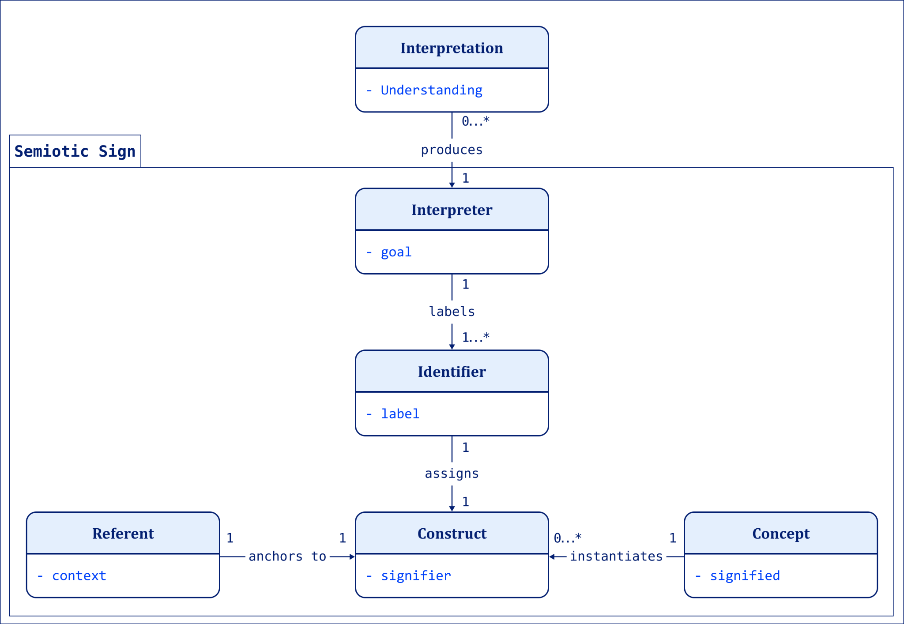

[Contents](../front-matter/contents.md) · [Notes](../references/notes/chapter-08.md) · [Bibliography](../references/bibliography/chapter-08.md)

# Chapter 8: The War of Signs

*Saussure, Peirce, and the Reconstruction of Meaning*

*In this chapter, I evaluate the semiotic frameworks of Ferdinand de Saussure and Charles Sanders Peirce against the cognitive-semiotic and computational principles I established in the previous chapter. Saussure sought to explain how linguistic systems produce stable meaning through structural relations among signs. Peirce sought to explain how signs participate in reasoning through interpretation and semiosis. Neither set out to develop an executable architecture of meaning. My objective is therefore not to reassess their original explanatory aims, but to determine whether their sign architectures satisfy the requirements of Constructivist Semiotics. This architectural compliance audit explains why I found it necessary to refactor the semiotic sign into a model that preserves conceptual identity, contextual anchoring, agentive interpretation, and goal-governed execution under formal constraint.*

*I retain Saussure's central insight that signs do not carry meaning intrinsically. The word justice does not contain justice within itself. It acquires stability through its place within a linguistic system, where its meaning differs from law, fairness, mercy, and revenge. Yet structural relations cannot determine how an interpreting agent should apply justice in a particular situation. A judge, legislator, and philosopher may all employ the same sign while arriving at different interpretations because linguistic structure cannot govern contextual application. I also retain Peirce's central insight that meaning requires interpretation rather than mere structural association. The sign justice may first generate the interpretant fairness. That interpretant then becomes a new sign that generates equal treatment under the law. That interpretant then becomes another sign that generates procedural due process. Peirce correctly explains how interpretation recursively generates further interpretation. However, his framework does not specify what authorizes an interpreting agent to terminate interpretation and act.*

*I show that these two frameworks become architecturally incomplete for complementary reasons. Saussure's dyadic sign explains structural relations among signs but cannot explain meaning as an agentive achievement. It collapses Concept, Construct, Identifier, Referent, Interpretation, and Interpreter into a structure that cannot preserve their distinct architectural roles. Peirce remedies part of this deficiency by distinguishing the representamen, object, and interpretant and by making interpretation central to the sign. Yet his framework still does not retain the full architecture required for executable meaning. It does not distinguish Concept from Construct, Interpretant from Interpreter, or contextual reference from goal-governed interpretation. Most importantly, because each interpretant becomes another sign, semiosis lacks a principled stopping condition. That openness explains inquiry, but execution requires termination. Courts must reach judgments. Programs must return values. Interpreting agents must determine whether meaning has succeeded or failed. These architectural limitations explain why I refactor the semiotic sign in Constructivist Semiotics.*

*In this chapter, I therefore deliver three results. First, I evaluate the semiotic frameworks of Saussure and Peirce against the cognitive-semiotic and computational principles established in the previous chapter. Second, I identify the enduring insights each framework contributes, including Saussure's rejection of intrinsic meaning and Peirce's account of interpretation as an active process. Third, I demonstrate why those insights require architectural refactoring before they can support executable meaning, specifically through intensional separation, context anchoring, agentive interpretation, error conditions, and goal-governed closure.*

*I conclude that neither static structure nor unbounded semiosis can explain meaning as an executable achievement. A viable semiotic theory must preserve the distinct architectural constituents of meaning while coordinating them within a unified, goal-governed system that explains how interpretation succeeds, fails, and terminates.*

*In [Chapter 9](../part-4/chapter-09.md), “Emotions Are Made, Not Triggered: How We Construct Emotional Meaning,” I extend Constructivist Semiotics from meaning to emotion. If agents construct meaning through governed interpretation, then stimuli cannot trigger emotions by themselves. Instead, agents construct emotions by interpreting bodily states, contextual information, conceptual knowledge, and goals within the semiotic architecture developed throughout this book.*

In [Chapter 7](chapter-07.md), I established Constructivist Semiotics as an architecture of meaning by defining its foundational and corollary cognitive-semiotic and computational principles. Those principles now serve as the architectural benchmark for evaluating the dominant historical frameworks of semiotics. I do not revisit the explanatory problems Ferdinand de Saussure and Charles Sanders Peirce originally set out to solve. Saussure sought to explain how linguistic systems generate stable meaning through structural relations among signs.<a href="../references/notes/chapter-08.md#note-1">1</a> Peirce, in turn, explained how signs take part in reasoning through interpretation and semiosis.<a href="../references/notes/chapter-08.md#note-2">2</a> Instead, I evaluate whether their sign architectures satisfy the requirements of executable meaning.

This architectural compliance audit serves two purposes. First, it identifies the enduring insights from Saussure's and Peirce's frameworks that Constructivist Semiotics incorporates. Second, it demonstrates why their historical sign architectures require refactoring before they can support meaning as an agentive, executable cognitive achievement. That refactoring incorporates conceptual identity, contextual reference, interpretive governance, agency, and goal-governed execution while maintaining the architectural integrity that executable meaning requires.

A theory earns its place by its explanatory power rather than by its historical influence. I therefore examine the semiotic frameworks of Saussure and Peirce as architectural designs rather than objects of historical reverence. Their historical importance is not in question. The question is whether their architectures continue to support meaning as an executable cognitive achievement. Only an architecture that maintains its constituent distinctions throughout interpretation and execution qualifies as both generative and computable.

For over a century, linguists, philosophers, and semioticians have sought to explain how signs come to mean, how meaning becomes shareable across minds, and how symbols function in cognition and social coordination. They recognized that meaning does not arise automatically from reference or sensation. Pointing to a tree does not explain what tree means, nor does seeing a patch of red explain what danger, love, or anger means. Meaning depends on structured relations and interpretive activity.

Ferdinand de Saussure defined the sign as a dyadic unit composed of a signifier and a signified. The signifier denotes the sound-image or symbolic form of the sign, while the signified denotes the mental concept conventionally associated with that form.<a href="../references/notes/chapter-08.md#note-3">3</a> By concept, Saussure refers to the sign's mental or psychological content rather than to the intensional constituent of Constructivist Semiotics. He treated the signifier and signified as inseparable components of a single sign and argued that their relationship is arbitrary rather than natural.<a href="../references/notes/chapter-08.md#note-4">4</a> Meaning therefore arises through the differential relations among signs within the linguistic system rather than through any intrinsic connection between a sign and the external world.<a href="../references/notes/chapter-08.md#note-5">5</a>

Charles Sanders Peirce (1839–1914) developed a general theory of signs grounded in logic and inquiry rather than linguistics.<a href="../references/notes/chapter-08.md#note-6">6</a> He proposed a triadic model consisting of the representamen, the object, and the interpretant.<a href="../references/notes/chapter-08.md#note-7">7</a> The representamen denotes the sign itself. The object denotes what the sign represents. The interpretant denotes the understanding or sign that the representamen produces rather than the act of interpretation itself. For example, the sign justice may produce the interpretant fairness. That interpretant may then function as a new sign capable of producing another interpretant, such as equal treatment under the law. Peirce therefore explains meaning as an ongoing process of semiosis in which each interpretant becomes another sign capable of generating further interpretation.<a href="../references/notes/chapter-08.md#note-8">8</a> Constructivist Semiotics instead explains meaning as the outcome of an interpretive act performed by an Interpreter using the constituents of the Constructivist Semiotic Sign. Meaning therefore terminates as an achieved result rather than continuing as an indefinite chain of interpretants. I return to this distinction later in the chapter when I evaluate Peirce's architecture against the requirements of executable meaning.

Neither framework, however, pursued the objective that motivates this chapter. I therefore examine whether their sign architectures remain adequate once meaning is treated as a cognitive-semiotic and computational architecture. This is not a historical reproach but an architectural audit motivated by a different explanatory objective. The results demonstrate why the historical semiotic signs require refactoring before they can support a cognitive-semiotic and computational architecture of meaning.

I continue to use the UML notation I introduced in [Chapter 2](../part-2/chapter-02.md) as the formal grammar for evaluating semiotic architectures. By representing types as classes, instances as objects, and symbolic identifiers as references, UML provides a neutral computational standard.<a href="../references/notes/chapter-08.md#note-9">9</a>

Before Ferdinand de Saussure, linguists approached language primarily as a historical and comparative discipline. They focused on reconstructing ancient languages, tracing sound changes, and mapping genealogies within language families. By comparing systematic phonetic patterns across Sanskrit, Greek, Latin, and Germanic languages, they reconstructed Proto-Indo-European. They treated language as a historical lineage that evolved over time rather than as a structured system operating in the present.

Linguists of the period concentrated on etymology, philology, and diachronic change. They traced the historical development of words, documented sound changes, and reconstructed language families, but they did not investigate how speakers generate meaning within a living linguistic system. Instead, they treated language as the product of historical development rather than as a structured network in which signs derive their value from their relations to one another.

Saussure redirected the field by rejecting the view that meaning arises from historical origin or from any natural connection between words and things. He argued that meaning arises from structural relations among signs within a system. Each sign gains value only through its differences from others.<a href="../references/notes/chapter-08.md#note-10">10</a> To make this case, he distinguished diachronic analysis from synchronic analysis. He argued that only the latter can explain how language produces meaning at a given moment.<a href="../references/notes/chapter-08.md#note-11">11</a>

Saussure did not merely seek a new way to catalog words. He sought to establish linguistics as a scientific discipline grounded in systematic structure rather than historical accident or psychological speculation. His primary objective was to explain how meaning arises within language itself, so he developed a model independent of individual speakers, intentions, or external objects.

Saussure thereby analyzed language as a self-regulating network of relations rather than as a collection of names attached to things. Within that network, each sign acquires value only through its position relative to other signs.

Saussure sought to identify the structural principles that make communication possible across a linguistic community. He viewed language as a social institution governed by conventions. These conventions exist independently of any particular act of speech.<a href="../references/notes/chapter-08.md#note-12">12</a> In formulating the dyadic sign, he intended to isolate the internal logic by which a linguistic system generates stable meanings through structural opposition. His model provides a descriptive foundation for how signs function collectively to ensure shared intelligibility.

<ins>Figure 8-1. Saussure's Dyadic Sign</ins>

Figure 8-1 depicts the dyadic sign, a unity composed of two inseparable components:

•	The Signifier (Sound-Image): This is the psychological imprint of the sound, such as the phonemes /kat/.<a href="../references/notes/chapter-08.md#note-13">13</a>

• The Signified (Concept): This is the abstract concept or mental image associated with the sound-image.

Saussure argues that the bond between these two elements is arbitrary. There is no natural or inherent reason why a specific sound-image must represent a specific concept.<a href="../references/notes/chapter-08.md#note-14">14</a> Instead, meaning arises exclusively through the differential relations between signs within the linguistic system (langue).

I now examine Saussure's dyadic sign to determine whether it can support a cognitive-semiotic and computational architecture of meaning. The results explain why Constructivist Semiotics refactors the historical semiotic sign while retaining Saussure's enduring insights.

<ins>Table 8-1. Saussure's Framework Evaluated Against the Cognitive-Semiotic Principles of Constructivist Semiotics</ins>

| Cognitive-Semiotic Principle | Saussure Result | Core Reason |
| --- | --- | --- |
| Principle 1. Meaning Is Not Intrinsic | Conforms | Saussure rejects intrinsic meaning and explains value through differences within langue. |
| Principle 2. Meaning Is Not Arbitrary | Conforms | Saussure treats the sign relation as arbitrary in origin, but langue constrains meaning once the system exists. |
| Principle 3. Interpretation Is Necessary | Does Not Conform | Saussure does not model interpretation as an explicit, goal-governed cognitive act. |
| Principle 4. Meaning Is Normative | Does Not Conform | Saussure does not explain how meaning answers to standards of correctness under context and goal. |
| Principle 5. Meaning Can Succeed or Fail | Does Not Conform | Saussure lacks criteria for interpretive success or failure in application. |
| Principle 6. Meaning Requires Perspective | Does Not Conform | Saussure locates meaning in the collective linguistic system rather than in an agent's situated perspective. |
| Principle 7. Goals Govern Meaning | Does Not Conform | Saussure does not define meaning relative to purpose, goal, or practical end. |

Saussure conforms to the first cognitive-semiotic principle because he rejects intrinsic meaning. The sound pattern “tree” does not contain tree-ness. English gives the word its value through its difference from “free,” “three,” and “bush.” This example shows why Saussure’s model helps defeat the idea that symbols carry meaning inside themselves.

Saussure also conforms to the second principle because he treats langue as a system that constrains meaning once speakers inherit it. Although the bond between signifier and signified begins arbitrarily, individual speakers cannot assign meanings at will. A speaker cannot simply decide that “dog” means “cat” within English. The system defines “dog” through its difference from “cat,” “wolf,” and “fox,” and that structure constrains meaning.<a href="../references/notes/chapter-08.md#note-15">15</a>

Saussure does not conform to the third principle because he does not model interpretation as an explicit, goal-governed cognitive act. The word “bank” illustrates the problem. Saussure can locate “bank” within the lexicon, but his framework does not explain how an interpreter determines whether “bank” refers to a riverbank or a financial institution in a specific situation.

Saussure does not conform to the fourth principle because his theory does not explain meaning as an answer to standards of correctness. The word “tree” can refer to an oak, a palm, a shrub, or a diagram depending on context and purpose. Saussure explains the word’s position within langue, but he does not supply rules that guide an interpreter from symbol to correct contextual application.

Saussure does not conform to the fifth principle because his framework lacks conditions for interpretive success or failure. If a speaker calls a mushroom a “tree,” Saussure can describe a deviation from linguistic convention, but he does not explain why the interpretation fails relative to the object, context, and purpose at stake.

Saussure does not conform to the sixth principle because his model shifts meaning away from the interpreter's standpoint and into the collective linguistic system. The word “bat” may refer to an animal or a piece of sporting equipment. Saussure’s framework explains the lexical difference, but it does not explain how an agent evaluates the situation and selects the relevant meaning.

Saussure does not conform to the seventh principle because he does not define meaning relative to a goal. A speaker may use “tree” to classify a plant, teach a child, give directions, or interpret a diagram. Each use requires a different purpose. Saussure’s model explains stable linguistic value, but it does not explain how goals govern meaning in use.

<ins>Table 8-2. Saussure's Framework Evaluated Against the Computational Principles of Constructivist Semiotics</ins>

| Computational Principle | Saussure Result | Core Reason |
| --- | --- | --- |
| Principle 1. Ontological Separability | Does Not Conform | Saussure’s signified collapses conceptual identity and mental representation. |
| Principle 2. Instantiation Integrity | Does Not Conform | Saussure does not distinguish definition from instance in executable terms. |
| Principle 3. Symbolic Reference Integrity | Does Not Conform | Saussure does not model the identifier as a stable symbolic pointer. |
| Principle 4. Context Anchoring | Does Not Conform | Saussure excludes situational context from the architecture of meaning. |
| Principle 5. Interpretive Governance | Does Not Conform | Saussure provides no executable procedure for interpretation. |
| Principle 6. Agent and Goal Preservation | Does Not Conform | Saussure removes agent-level goals from the architecture of meaning. |
| Principle 7. Executability Without Collapse | Does Not Conform | Saussure’s categories merge under formal modeling. |

I now audit Saussure’s dyadic sign against the computational principles of Constructivist Semiotics, using the UML class and object diagrams as the testing surface. The question is no longer whether Saussure describes meaning coherently, but whether his categories can survive formal modeling without collapsing the distinctions between concept, construct, symbol, context, and interpretation.

Saussure fails the first computational principle because his signified collapses conceptual identity and mental representation. A UML class must distinguish an abstract type, such as int, from a concrete value, such as 7. Saussure’s signified cannot preserve that distinction because it treats meaning as a psychological concept rather than as an architectural type with instantiation rules.

Saussure fails the second computational principle because his framework does not distinguish definition from instance in executable terms. The word “triangle” has value through its relation to “square,” but Saussure does not explain how a three-sided figure satisfies the definition of triangle while a four-sided figure fails it. The model describes relational value, but it does not govern instantiation.

Saussure fails the third computational principle because his signifier does not function as a stable symbolic pointer. The word “lead” may refer to a heavy metal or to a command to follow. Saussure can describe its differential value within language, but he does not provide an architectural role that lets an identifier point to different referents under different contexts.

Saussure fails the fourth computational principle because his model excludes situational context from the architecture of meaning. The word “sharp” changes its relevance when a speaker applies it to a knife, a musical note, or an intellect. Saussure’s framework can describe the word’s systemic value, but it cannot explain how context governs the correct application.

Saussure fails the fifth computational principle because he provides no executable procedure for interpretation. The word “valid” may refer to a legal argument, a logical inference, or a software input. Saussure’s model does not explain how an interpreter moves from the symbol to a concluded meaning under rules of correctness.

Saussure fails the sixth computational principle because he removes agent-level goals from the architecture of meaning. A speaker who calls a circle a “square” does not merely deviate from language; the speaker fails relative to a task, a purpose, or a standard of classification. Saussure can describe social conformity, but he cannot represent an agent who evaluates success conditions.

Saussure fails the seventh computational principle because his categories merge under formal modeling. To model “dozen,” a system must distinguish the word, the concept of twelve, and a specific quantity of items. Saussure’s dyadic sign cannot preserve those separations as operational roles. It describes how signs relate within a system, but it does not supply separable components that formal execution can test.

Saussure’s framework fails every computational requirement. His distinctions do not survive formal modeling, execution, or constraint. This failure confirms that the dyadic sign offers only descriptive influence. It remains architecturally non-executable. By locating meaning entirely within langue, Saussure explains how symbols relate to one another but not how an agent produces, tests, or evaluates meaning in use.

The model collapses because it lacks an account of agency. Meaning exists prior to any interpreter and remains unaffected by goals or evaluative stakes. Consequently, the system cannot explain correctness, error, or revision. Saussure also provides no architectural separation between conceptual structure and contextual instantiation. His “signified” fails to function as an intensional universal capable of governing specific instances.

Ultimately, Saussure describes how symbols relate, but not how meaning works. His theory rests on descriptive relations rather than enforceable constraints. What he offers is linguistically insightful but architecturally inert. Constructivist Semiotics requires an executable blueprint; Saussure provides a descriptive abstraction.

Saussure’s framework fails as a generative architecture, yet it offers several indispensable insights. Constructivist Semiotics preserves these principles and re-grounds them within an executable architecture of meaning.

Rejection of Intrinsic Meaning: Saussure decisively rejects the idea that meaning resides in symbols themselves. He denies resemblance, material form, or causal linkage as sources of meaning.

Constructivist Semiotics fully preserves this insight under the Foundational Cognitive–Semiotic Principle: meaning is a dependent achievement of rational interpretation under constraint. Symbols remain inert until interpretation binds identifiers, concepts, constructs, and referents relative to a goal. Meaning never resides in the symbol itself.

Meaning Is Constrained, Not Arbitrary: Saussure correctly insists that meaning is rule-bound and socially constrained, not a matter of individual whim.

Constructivist Semiotics preserves constraint under Principle 2: Meaning Is Not Arbitrary. Constraint no longer arises from static differential position alone, but from governed interpretation operating under conceptual identity, contextual anchoring, and goal-relative evaluation. Error and correction become possible without surrendering objectivity.

Relational Identity of Symbols: Saussure shows that symbols acquire identity through relations within a system rather than in isolation.

Constructivist Semiotics formalizes relational identity through Principle 1: Ontological Separability. Concepts gain identity through structured relations within a system while remaining ontologically distinct. UML class diagrams preserve relational definition without collapsing constituents.

Separation of Meaning From Direct Reference: Saussure rejects naïve realism by denying that meaning arises directly from reference to external objects.

Constructivist Semiotics preserves this distinction under Principle 3: Symbolic Reference Integrity. Identifiers function as symbolic pointers that refer without becoming their referents. Reference is restored as a governed component mediated by context and interpretation, not as an intrinsic source of meaning.

Stability of Shared Meaning Systems: Saussure identifies langue as a socially stabilized system that persists beyond individual minds.

Constructivist Semiotics preserves shared stability under Principle 6: Meaning Requires Perspective, while refusing to eliminate agency. Social symbol systems constrain interpretation, but meaning still exists only when an agent evaluates a sign relative to a goal. Stability informs interpretation; it does not replace it.

Language as a Structured System: Saussure treats language as an organized system governed by internal relations rather than as a loose collection of names.

Constructivist Semiotics preserves systemic structure under Principle 7: Executability Without Collapse. The architecture must survive formal modeling without merging roles or erasing constraints. UML enforces system-level organization while maintaining separability across execution.

Saussure contributes indispensable constraints: meaning is not intrinsic, not arbitrary, not atomistic, and not reducible to reference, but mislocates them entirely in static structure; Constructivist Semiotics preserves these insights while re-grounding them in governed interpretation, contextual anchoring, and goal-relative execution.

Saussure explains how linguistic systems stabilize meaning. However, his exclusion of interpretation, agency, and inference leaves the theory incomplete and compels a shift to Peirce’s theory of signs.

Pragmatic theories do foreground evaluative dimensions of meaning: speaker intention, context, and felicity conditions. Nonetheless, they do not provide a fully developed architectural account of constraint propagation across interpretive acts.<a href="../references/notes/chapter-08.md#note-16">16</a>

Peirce confronted the problem of meaning from the perspective of logic, science, and inquiry. He worked against a different background and addressed a different failure. Where nineteenth-century linguistics remained historical, nineteenth-century philosophy struggled to explain how thought, reference, and knowledge could be objective without appealing to intuition or metaphysics.

The dominant philosophical frameworks of Peirce’s time treated meaning either as a mental association or as a direct correspondence between ideas and things. Empiricism reduced meaning to sensation. Rationalism grounded it in innate ideas. Both approaches failed to explain how signs support reasoning, communication, and scientific discovery. Neither could account for how meaning develops through inquiry rather than appearing fully formed.

Peirce rejected these limitations by reframing meaning as a logical and inferential process. He approached signs not as linguistic units but as the basic instruments of cognition. His aim was not to explain language as a social structure but to explain how reasoning itself is possible. He treated semiotics as a branch of logic rather than linguistics, placing it at the foundation of epistemology and scientific method.<a href="../references/notes/chapter-08.md#note-17">17</a>

To accomplish this, Peirce expanded the sign beyond Saussure’s dyadic relation. He introduced a triadic structure consisting of the representamen, the object, and the interpretant. This allowed him to explain how a sign can stand for something to someone in virtue of an interpretive effect. Meaning, on this account, arises through semiosis: a process in which one sign generates another through inference and interpretation.<a href="../references/notes/chapter-08.md#note-18">18</a>

In Figure 8-2, Charles Sanders Peirce presents a triadic model of the sign, which differs from Saussure’s dyadic approach by introducing a third element to mediate meaning. This structure is often represented as a triangle to show that meaning is not fixed but arises through the dynamic process of semiosis.

<ins>Figure 8-2. Peirce's Triadic Sign</ins>

Peirce’s model defines a sign as an irreducible relationship between three parts:

The Representamen: the physical or perceptible form that the sign takes, such as a written word, a sound, or a gesture. Peirce sometimes calls this the sign vehicle.

The Object: the thing, idea, or event to which the sign refers. Peirce further distinguishes the dynamical object, the object as it exists in reality, from the immediate object, the object as the sign represents it.<a href="../references/notes/chapter-08.md#note-19">19</a>

The Interpretant: the mental effect or sense an observer makes of the sign. The interpretant is not the interpreter. It is a new sign that translates and clarifies the relation between the representamen and the object.<a href="../references/notes/chapter-08.md#note-20">20</a>

Unlike Saussure’s model, which focuses on the internal linguistic structure, Peirce’s triadic model is grounded in logic and inquiry. The inclusion of the interpretant allows for what Umberto Eco later called “unlimited semiosis,” where one interpretation leads to another sign, which in turn creates another interpretant, forming an endless chain of meaning.<a href="../references/notes/chapter-08.md#note-21">21</a>

Peirce’s central objective was to show that meaning is neither a static mental image nor a fixed structural relation. It is an activity governed by reasoning. He sought to ground meaning in habits of inference, continuity, and law-like regularities rather than in psychological states or linguistic conventions. In doing so, he shifted semiotics toward process, mediation, and logic.

Unlike Saussure, Peirce did not aim to isolate a closed system of signs. He aimed to explain how signs participate in an open process of inquiry. He treated meaning as something that unfolds through interpretation across time, potentially without final termination. His model emphasizes mediation, inferential development, and the generative nature of sign activity.

<ins>Table 8-3. Peirce's Framework Evaluated Against the Cognitive-Semiotic Principles of Constructivist Semiotics</ins>

| Cognitive-Semiotic Principle | Peirce Result | Core Reason |
| --- | --- | --- |
| Principle 1. Meaning Is Not Intrinsic | Conforms | Peirce rejects meaning as intrinsic to the sign vehicle and grounds meaning in semiosis. |
| Principle 2. Meaning Is Not Arbitrary | Conforms | Peirce treats interpretation as law-like, inferential, and constrained by habits of reasoning. |
| Principle 3. Interpretation Is Necessary | Conforms | Peirce places interpretation at the center of semiosis through the interpretant. |
| Principle 4. Meaning Is Normative | Does Not Conform | Peirce does not provide a determinate standard of correctness under a goal. |
| Principle 5. Meaning Can Succeed or Fail | Does Not Conform | Peirce does not supply explicit success and failure conditions for context-bound interpretation. |
| Principle 6. Meaning Requires Perspective | Does Not Conform | Peirce's interpretant is not the interpreter, so his model does not preserve the agent's situated perspective. |
| Principle 7. Goals Govern Meaning | Does Not Conform | Peirce’s open-ended semiosis does not terminate interpretation through a governing purpose. |

I now evaluate Peirce’s framework against the cognitive-semiotic principles of Constructivist Semiotics. This audit determines whether Peirce’s process-oriented model can preserve conceptual structure, contextual constraint, interpretive governance, and agent-level evaluation under formal execution, or whether its openness dissolves into architectural instability under constraint.

Conformity in this evaluation depends on whether a framework models interpretation as an agentive, context-sensitive, and constrained achievement of meaning.

Peirce conforms to the first cognitive-semiotic principle because he rejects meaning as something the sign vehicle carries by itself. A written word, a smoke signal, or a gesture does not mean by its material form alone. It becomes meaningful only when semiosis relates it to an object through an interpretant.

Peirce conforms to the second principle because he treats interpretation as law-like and inferential rather than arbitrary. If smoke indicates fire, the relation does not depend on personal whim. It depends on a habit of reasoning that links sign, object, and interpretant through a rule-governed expectation.

Peirce conforms to the third principle because interpretation stands at the center of his model. A sign does not merely connect to an object; it produces an interpretant. For example, a red traffic light does not simply exist as a red object. It leads an interpreter to the thought “stop,” which then guides action.

Peirce does not conform to the fourth principle because his model does not provide a determinate standard of correctness under a goal. The sign “justice” may lead to legal doctrine, moral desert, equality, punishment, or institutional legitimacy. Peirce explains how one interpretation leads to another, but he does not supply the rule that determines which interpretation should govern a particular action.

Peirce does not conform to the fifth principle because his model lacks explicit success and failure conditions for context-bound interpretation. If a doctor interprets a symptom as evidence of one disease rather than another, the interpretation must succeed or fail relative to diagnosis and treatment. Peirce explains the recursive generation of interpretants, but he does not define the point at which an interpretation succeeds for a specific goal.

Peirce does not conform to the sixth principle because the interpretant is not the interpreter and does not supply an interpreter's standpoint. The interpretant is another sign or effect within semiosis. If a jury interprets evidence, the jury acts as an evaluating agent with duties, goals, and responsibility. Peirce’s triad models the interpretive effect, but it does not preserve the agent as the one who evaluates and answers for the interpretation.

Peirce does not conform to the seventh principle because open-ended semiosis does not terminate interpretation through a governing purpose. A sign can generate another sign indefinitely. That openness helps explain inquiry, but action requires closure. If a driver sees a stop sign, interpretation must end in a practical judgment: stop now. Peirce explains the expansion of meaning, but he does not explain how a goal closes the chain.

<ins>Table 8-4. Peirce's Framework Evaluated Against the Computational Principles of Constructivist Semiotics</ins>

| Computational Principle | Peirce Result | Core Reason |
| --- | --- | --- |
| Principle 1. Ontological Separability | Partially Conforms | Peirce distinguishes representamen, object, and interpretant, but his object category blurs universals, percepts, and concrete existents. |
| Principle 2. Instantiation Integrity | Does Not Conform | Peirce does not preserve the distinction between Concept and Construct in executable terms. |
| Principle 3. Symbolic Reference Integrity | Does Not Conform | Peirce allows reference to become recursive rather than stable. |
| Principle 4. Context Anchoring | Does Not Conform | Peirce does not anchor interpretation to a determinate contextual Referent. |
| Principle 5. Interpretive Governance | Does Not Conform | Peirce does not provide a rule-constrained interpretive process that permits success or failure. |
| Principle 6. Agent and Goal Preservation | Does Not Conform | Peirce treats the interpretant as a logical consequence rather than as an output evaluated by a goal-directed agent. |
| Principle 7. Executability Without Collapse | Does Not Conform | Peirce’s model collapses into infinite recursion under formal execution. |

I now apply the computational audit to Peirce’s triadic model. While Peirce introduces a third element, the interpretant, to bridge the gap between sign and object, I must determine if this triadic relation provides the structural stability required for formal execution.

Conformity in this evaluation is assessed relative to computational principles, which concern whether those same structures are specified with sufficient architectural clarity to support generative, evaluable, and executable implementation.

Principle 1. Ontological Separability. Partially conforms.

Peirce distinguishes the representamen, the object, and the interpretant, which suggests an awareness of ontological differentiation. However, his definition of the object is excessively broad. He groups abstract universals, mental percepts, and concrete existents into a single category. In the UML class diagram, the class int must remain distinct from a specific instance such as 7. Peirce’s model lacks the architectural layers required to prevent these roles from bleeding into one another. He identifies the need for parts but fails to provide structural firewalls between them.

Principle 2. Instantiation Integrity. Does not conform.

Peirce treats the object as an undifferentiated category, which prevents his framework from preserving the distinction between Concept and Construct in an executable architecture. The theory treats the concept of justice and a specific court ruling as objects of semiosis without enforcing a hierarchy between universal and particular. In the UML model, the object 7 must instantiate the class int while remaining distinct from it. Peirce’s triadic relation describes a flow of meaning rather than a rule-governed structure of instantiation. It provides no mechanism to ensure that an instance conforms to its type.

Principle 3. Symbolic Reference Integrity. Does not conform.

Peirce partially recognizes symbolic reference through his notion of the index. However, his framework does not preserve the architectural distinction between the Identifier, the Construct, and the Referent. The Identifier becomes recursively absorbed into semiosis rather than remaining a stable symbolic pointer. The identifier num, the variable that holds 7 in the UML model, quickly dissolves into an interpretant, which then becomes a new sign. Reference therefore becomes recursive rather than fixed. In a computational system, a reference must remain an anchor to an object. Peirce’s model turns reference into a catalyst for infinite sign generation rather than a stable link.

Principle 4. Context Anchoring. Does not conform.

Peirce acknowledges the ground of a sign but does not anchor interpretation to a determinate contextual Referent that constrains relevance. The meaning of 7 depends on whether the context is days of the week or bits in a byte. Peirce’s framework treats context as implicit within interpretation rather than as an explicit architectural component. There is no slot in the model where context functions as a fixed variable that governs correctness. Without context anchoring, the triadic relation lacks a frame that stabilizes meaning.

Principle 5. Interpretive Governance. Does not conform.

Peirce does not provide a rule-constrained interpretive process that permits success or failure. He characterizes interpretation as unlimited semiosis, in which one sign gives rise to further interpretation without principled finality. This provides a descriptively accurate account of how meaning unfolds through inquiry and reflection. Peirce did hold that the ultimate logical interpretant is a habit, a disposition to act, which gives semiosis a practical resting point.<a href="../references/notes/chapter-08.md#note-22">22</a> But a habit is a general disposition. It does not supply a goal-relative criterion by which a particular act of interpretation succeeds or fails. However, Peirce does not specify how interpretation achieves context-relative closure when meaning must be resolved for action, decision, or execution. As a result, his framework remains architecturally incomplete relative to systems that require termination conditions, such as generative or computational procedures. A program requires a stopping condition—a point at which interpretation concludes and returns a value. In the UML activity diagram, execution must reach an exit node. Peirce's model supplies only additional nodes, ensuring perpetual continuation rather than resolution.

Principle 6. Agent and Goal Preservation. Does not conform.

Peirce does not preserve the Interpreter as a goal-directed evaluating agent. Instead, he treats the interpretant as a logical consequence rather than as the product of an agent who evaluates interpretation relative to a governing goal. In the Constructivist Semiotics architecture, the Interpreter class evaluates a sign relative to a Goal in order to determine success or failure. Peirce’s semiosis proceeds autonomously, governed by logical propagation rather than agentive purpose. Without an agent to supply a goal, interpretation has no reason to stop and no criterion by which it can fail.

Principle 7. Executability Without Collapse. Does not conform.

Peirce's triadic model cannot preserve the distinctions it claims to make under formal execution because unlimited semiosis collapses the architecture into infinite recursion. The interpretant of 7 generates a new sign, which generates another interpretant, and so on without termination. The architecture cannot sustain execution under formal constraint. While Peirce offers a powerful description of the flow of thought, he does not provide a blueprint for a machine of thought. The absence of stopping conditions and structural boundaries renders the model non-executable.

Like Saussure, Peirce fails as a generative architecture, yet he offers several indispensable insights. Constructivist Semiotics preserves those insights within an executable architecture of meaning.

Peirce correctly identifies interpretation as essential to meaning. By introducing the interpretant, he rejects the idea that symbols or structural relations alone create meaning. Constructivist Semiotics preserves this insight under Principle 3: Interpretation Is Necessary. Meaning exists only where an agent interprets a sign relative to a goal under constraint. Interpretation becomes an operation that can succeed or fail.

Peirce also reconceives meaning as an active process of semiosis rather than a static pairing of elements. Meaning unfolds through inference and reasoning rather than residing in fixed structures. Constructivist Semiotics preserves this insight under Principle 5: Meaning Can Succeed or Fail. Agents produce meaning through interpretive process, but Constructivist Semiotics adds termination conditions, correctness criteria, and evaluative closure. It keeps process without infinite regress.

Peirce grounds meaning in inference rather than resemblance or association. Signs mean by standing in logical relations that support reasoning and expectation. Constructivist Semiotics preserves inferential meaning under Principle 4: Meaning Is Normative. Interpretation answers to conceptual identity, contextual parameters, and agent goals. Inference becomes executable rather than metaphysical.

Peirce expands semiotics beyond language to include diagrams, indices, icons, and logical signs. Meaning does not belong only to linguistic structure. Constructivist Semiotics preserves this breadth under Principle 1: Meaning Is Not Intrinsic. Meaning does not belong to words, images, or symbols of any kind. It arises through interpretation across representational media, including formal diagrams and computational models.

Peirce insists that signs mediate between thought and world rather than mirroring reality directly. Meaning remains indirect, inferential, and representational. Constructivist Semiotics preserves mediation under Principle 3: Symbolic Reference Integrity. Identifiers refer without becoming their referents. Context and interpretation determine how reference contributes to meaning without collapsing meaning into world-mapping.

Peirce treats meaning as lawful rather than private psychological intuition. Semiosis follows rational patterns through habits, regularities, and inference. Constructivist Semiotics preserves lawfulness under Principle 2: Meaning Is Not Arbitrary and Principle 4: Meaning Is Normative. Laws become enforceable constraints within a formal architecture rather than abstract metaphysical tendencies.

Peirce also resists subjectivism by locating meaning within shared inferential practice rather than private mental states. Constructivist Semiotics preserves objectivity under Principle 6: Meaning Requires Perspective. Meaning exists only for agents, but shared structures, contexts, and goals constrain correctness rather than intuition or consensus alone.

Peirce contributes what Saussure lacks: interpretation, inference, mediation, and process. He correctly identifies meaning as something done, not merely structured. However, he leaves that process without termination or architectural stability. Constructivist Semiotics preserves Peirce's deepest insights while supplying what his system never provides: intensional separation, contextual anchoring, agentive purpose, and executable governance. Peirce explains why meaning must be active. Constructivist Semiotics explains how meaning can work.

I have now completed the audit of Saussure's and Peirce's frameworks against the architectural and principled requirements of Constructivist Semiotics. Tables 8-1 and 8-2 summarize Saussure's conformity with the cognitive-semiotic and computational principles, while Tables 8-3 and 8-4 present the corresponding results for Peirce.

I must now confront the systemic issues that haunt these historical frameworks. The first issue, recursion and unlimited semiosis, arises from the work of Charles Sanders Peirce and Jacques Derrida. Peirce identifies a genuine phenomenon: interpretation can generate further interpretation. A sign produces an interpretant, which itself becomes a sign, and semiosis can continue indefinitely. Derrida later radicalizes this problem by emphasizing the perpetual deferral of meaning. That move sharpens the problem of interpretive closure, but it does not change the structural issue already present in Peirce's framework.<a href="../references/notes/chapter-08.md#note-23">23</a>

Consider the word justice. It can prompt interpretation through legal doctrine, moral intuition, and historical precedent. Each interpretation invites another, and no single meaning automatically closes the chain. This phenomenon accurately describes philosophical analysis. But when I map it onto a computational model, it becomes fatal. Interpreting the value 7 yields an interpretant that becomes a new sign, which yields another interpretant. In a UML activity diagram, the process lacks an exit node. Execution never terminates. Constructivist Semiotics accepts recursion as possible but rejects it as necessary. A loop without a stopping condition is not meaning; it is drift. A theory that cannot stop cannot act.

This need for closure leads directly to telos and stopping conditions for meaning. Derrida, by contrast, treats every stopping point as provisional, never a final presence of meaning. Constructivist Semiotics adopts the opposite position: meaning requires telos. Interpretation stops not because reality ends, but because purpose fixes relevance. A goal defines when interpretation has succeeded or failed. In a court ruling, the meaning of guilty must terminate because the goal is adjudication. Similarly, a function that evaluates if (num > 5) must return true or false. An interpreter that never returns a value does not compute meaning; it malfunctions. Telos supplies the stopping condition that neither Derrida nor Peirce can justify within their frameworks.

Without stopping conditions, a system cannot identify error, misinterpretation, or type violation. Saussure and Peirce both struggle to explain error in a principled way. If structure fixes meaning entirely, or if interpretation endlessly defers meaning, then misinterpretation becomes either impossible or meaningless. Constructivist Semiotics treats error as diagnostic. Error reveals the boundaries of meaning. Calling a whale a fish fails because biological classification imposes constraints. Correction restores conceptual integrity. In a formal system, assigning the string "seven" to an int variable produces a type error. The system rejects the interpretation. Meaning fails visibly and objectively. Error is not noise; it proves that interpretation operates under law. A system that cannot fail cannot mean.

Finally, I must resolve the recurring confusion between identity and reference stability. Saussure collapses identity into relational difference, while Peirce allows reference to proliferate through interpretants. Constructivist Semiotics insists on stability at both levels. The word bank can refer to a financial institution or a river edge. Reference shifts with context, but each concept retains its identity. Confusing the two produces ambiguity, not meaning. In code, the identifier num may reference different values over time, but the class int preserves its identity. Identity belongs to concepts; reference belongs to context. Meaning requires both to remain distinct under execution.

These fault lines reveal that recursion without telos dissolves meaning, and interpretation without stopping conditions cannot execute. Constructivist Semiotics resolves these tensions by imposing architectural discipline. It permits recursion but requires termination. It explains error as failure under law. It stabilizes identity while allowing reference to vary. Meaning survives not because it floats freely, but because it works under constraint.

Constructivist Semiotics therefore accounts for the formal conditions required to explain how meaning exists, functions, succeeds, and fails. It does so while intentionally excluding affective salience, goal genesis, non-symbolic cognition, historical evolution, and phenomenology. These exclusions are not oversights. They protect the formal integrity required for executable meaning.

The preceding analysis isolates a common architectural gap in classical semiotic theories. Saussure and Peirce each capture essential aspects of meaning: structure, difference, mediation, and process. Yet neither supplies a model that preserves these distinctions under execution. What is missing is not insight, but architecture: a formally articulated system that separates concepts from instances, anchors interpretation to referents, assigns agency to an interpreter, and supplies goal-relative conditions for success and termination. Figure 8-3 introduces the Constructivist Semiotic Sign, which integrates these requirements into a single executable architecture.

<ins>Figure 8-3. Constructivist Semiotic Sign UML Class Diagram</ins>

Figure 8-3 illustrates the Constructivist Semiotic Sign as a multi-constituent formal architecture. Unlike historical dyadic or triadic models, this framework uses architecture and governing principles to maintain strict boundaries between the elements of meaning so that they remain operationally distinct under formal execution.

This model resolves the architectural failures identified in Saussure and Peirce. It prevents the collapse of conceptual identity, the Concept, into symbolic labels, the Identifier, or specific instances, the Construct. By including the Interpreter and Referent, it models agency, goal-orientation, and context anchoring as necessary conditions for meaning as a computable achievement.

In this chapter, I have held the two pillars of modern semiotics, Ferdinand de Saussure and Charles Sanders Peirce, to the architectural standard of Constructivist Semiotics. I have also tested their frameworks against the formal rigor of the UML diagrams. That audit establishes three core results.

First, I identified the structural limits of the dyadic and triadic models. Saussure's model provides a descriptive inventory of linguistic relations, but it cannot account for the agent-level execution of meaning. It collapses universals and particulars into the signified, leaving the model computationally inert. Peirce's model correctly identifies meaning as a process of interpretation, but it supplies no stopping conditions. It produces an infinite loop of semiosis that lacks the boundaries and termination points required for a functional architecture.

Second, I recovered the essential insights these frameworks still provide. Saussure's rejection of intrinsic meaning remains indispensable. Peirce's emphasis on inferential process remains indispensable. Constructivist Semiotics does not discard these traditions. It preserves their valid observations by supplying the intensional separation, contextual anchoring, and goal-governed interpretation they lack.

Finally, I resolved the cross-cutting crises of semiotic drift. By imposing the discipline of telos, I showed that recursion without a stopping condition is not meaning, but malfunction. I also showed that a system of meaning must allow objective failure through error and type violation. If a system cannot fail, it cannot mean.

This chapter confirms that meaning survives not because signs defer meaning endlessly, but because interpretation functions as a governed achievement under formal constraint. I have cleared the historical ground. I can now move from the evaluation of past frameworks to the construction of a generative architecture of meaning.

In this chapter and the one preceding it, I examined the macro-semiotic architecture of meaning. I defined the structure of the sign, the principles that govern interpretation, and the conditions under which meaning succeeds or fails. I tested historical frameworks against these requirements. I showed that meaning emerges only when a complete semiotic architecture remains intact under constraint and execution.

Constructivist Semiotics provides a generative architecture of meaning because it transforms semiotic theory from descriptive taxonomy into executable structure. Saussure and Peirce each identify essential aspects of meaning, yet they leave those aspects architecturally unstable. Constructivist Semiotics integrates their valid insights into a single system where distinctions survive constraint, interpretation, and execution.

The disciplined separation and coordination of components constitutes the defining achievement of this framework. The architecture maintains strict boundaries between concepts, constructs, identifiers, referents, interpretation, and the interpreter. This structure prevents the category collapse that renders historical models non-generative. Meaning does not reside in structure alone or in unbounded inference. It emerges as the outcome of a governed interpretive sequence.

This architecture allows execution, testing, and evaluation without metaphor because it aligns with formal modeling disciplines. It treats meaning as a procedural achievement. It produces a result when an agent interprets an identified instance of a concept within a context and toward a goal. Constructivist Semiotics qualifies as generative for this reason. It does not merely describe how signs relate. It specifies the architectural conditions under which an interpreter can produce, constrain, and resolve meaning.

The next chapter applies this architecture to emotion. If agents make meaning through governed interpretation, then stimuli alone cannot trigger emotion. An agent must construct emotion by interpreting bodily, contextual, conceptual, and goal-relative information as an emotion. I now move from the architecture of meaning to the architecture of emotional construction.

This is the task of [Chapter 9](../part-4/chapter-09.md).
