[Contents](README.md) · [Notes](../references/notes/chapter-09.md) · [Bibliography](../references/bibliography/chapter-09.md)

# Chapter 9: Emotions Are Made, Not Triggered: How We Construct Emotional Meaning

*In Chapter 8, I established that meaning is not intrinsic but is achieved through an agent interpreting signs under constraint. Saussure showed that signs gain stability through relations, and Peirce showed that interpretation is indispensable, but neither framework secured the full architecture of the Constructivist Semiotic Sign. In this chapter, I instantiate that architecture as the Constructivist Semiotic Model of Emotions (CSME). If emotional meaning is a semiotic achievement rather than an intrinsic property of bodily states, then emotion cannot be identified with physiological affect or bodily activity. I must therefore explain what it means for an agent to feel, how feeling becomes semiotically available for interpretation, and how an agent constructs emotional meaning as an interpretive act.*

*This chapter also completes the metamorphosis of the ontology. Feeling replaces the provisional construct of phenomenological experience. Emotion replaces evaluative orientation. Physiological affect enters as the bodily substrate that prepares feeling without becoming feeling or emotion.*

*I first conduct a weighted score matrix (WSM) trade study. It evaluates the principal theories of emotion against the definitional and analytic criteria of Part II and the cognitive-semiotic and computational criteria of Part III, with showstopper criteria that eliminate a candidate on failure.*

*The study does not pick a favorite theory. It decides which contributions I preserve as inputs to four deliverables.*

*The first deliverable is the Constructivist Semiotic Model of Emotions (CSME), a formal cognitive-semiotic architecture that specifies the identity conditions and semiotic structure through which an agent constructs emotional meaning.*

*The second deliverable is the Constructivist Computational Model of Emotions (CCME), an executable specification that tests the CSME for internal consistency by preserving its ontological distinctions under computational constraint.*

*The third deliverable is the Constructivist Interpretation Theory of Emotion (CITE), which defines emotion as an interpretive act through which an agent assigns meaning and significance to feeling, rather than as the output of appraisal or bodily processes.*

*The fourth deliverable is Emotional Constructivism, the broader philosophical position that emotions are cognitive-semiotic constructions through which agents construct emotional meaning rather than discover it as an intrinsic property of bodily states. Its defining claim is agentic: because an agent constructs emotional meaning, a rational agent can inspect and redesign the interpretive architecture that produces it.*

*I then demonstrate the CSME architecture computationally through five C# projects:*

*1.	Project 1 tests identity conditions by showing that a concept governs admissible instances.*

*2.	Project 2 tests the bridge between semiotic availability and semantic achievement by showing that feeling can become available for interpretation independent of meaning.*

*3.	Project 3 tests goal-governed interpretation by showing that the same feeling-in-context can yield different emotions under different goals.*

*4.	Project 4 tests phase separation by preserving the ontological distinction between situation, physiological affect, feeling, and emotional interpretation.*

*5.	Project 5 tests revisability by demonstrating that an agent can revise emotional meaning while preserving the underlying feeling.*

*Together, these projects show why computation matters: executable form forces the architecture to preserve distinctions that prose can too easily blur.*

*Together, these deliverables establish emotion as a cognitive-semiotic achievement that an agent constructs through interpretation. In the next chapter, I move upstream to the symbolic conditions that make signs, concepts, and understanding possible.*

In [Chapters 7](../part-3/chapter-07.md) and [8](../part-3/chapter-08.md), I established Constructivist Semiotics as the cognitive-semiotic architecture that specifies the structural requirements for constructing meaning. It does not explain what it means for an agent to feel or how an agent constructs emotional meaning by interpreting feeling.

A central limitation in many theories of emotion is architectural rather than empirical. They collapse affect, feeling, and emotion into stages of one continuum. They then cannot explain why physiological affect can exist without emotional meaning, or how the same feeling can support different emotions.

Many theories of emotion lack a principled account of the transition from physiological affect, to phenomenological feeling, to cognitive-semiotic emotion. Panksepp treats affective systems as evolutionarily grounded causal substrates but does not distinguish physiological affect from emotional meaning.<a href="../references/notes/chapter-09.md#note-1">1</a> Damasio distinguishes bodily states from conscious feeling, yet feeling remains closely tied to the body's causal processes rather than to an autonomous interpretive act.<a href="../references/notes/chapter-09.md#note-2">2</a> Barrett correctly rejects intrinsic emotional essences and emphasizes construction, but, as I read it, her framework deliberately integrates feeling, conceptual categorization, and emotional meaning within a unified predictive process; for my purposes, that integration leaves their distinct roles unspecified.<a href="../references/notes/chapter-09.md#note-3">3</a> Appraisal theories, including those of Lazarus and Scherer, explain how situations acquire relevance through evaluation, yet they identify appraisal itself with emotional meaning rather than distinguishing appraisal from interpretation.<a href="../references/notes/chapter-09.md#note-4">4</a> Together, these approaches collapse physiological affect, phenomenological feeling, and cognitive-semiotic emotion into different stages of a single process. The result is the same: they fail to distinguish semiotic availability from semantic achievement and therefore cannot explain emotion as an agent's interpretive construction of meaning.

The gravest consequence of this missing bridge is the loss of interpretive governance. If emotional meaning is the output of appraisal, prediction, or biology, no principled jurisdiction remains for judging an emotion correct or mistaken. These theories describe how emotional states arise. They cannot explain how agents justify, revise, or take responsibility for the meanings they construct.

Sensation is not feeling. Feeling is not meaning. Semiotic availability is not semantic achievement. Appraisal is not interpretation. Each statement marks a necessary identity condition for a categorically distinct cognitive or semiotic state. Failure to preserve those identity conditions renders emotion formally indeterminate.

I pursue three objectives. First, I resolve the ontological collapse by establishing the identity conditions that distinguish physiological affect, feeling, and emotion.

Second, I specify the bridge between semiotic availability and semantic achievement: how affect becomes available as feeling without constituting meaning, and how an agent constructs meaning by interpreting that feeling.

Third, I restore interpretive governance by locating emotional meaning in an act an agent performs, so that it admits correctness, error, justification, revision, and responsibility. I treat agency as an architectural requirement. The following illustration shows the problems these objectives address.

When I walk alone at night and hear footsteps accelerating behind me, I first perceive an external situation. My body registers heightened physiological affect as arousal rises and attention narrows. I then feel tension and urgency. At this point, several questions arise. Does what I feel already constitute emotional meaning, or does it merely make my feeling available for interpretation? If I initially construct fear, but then recognize the approaching person as a friend and construct relief, how do I explain those different emotional meanings if I continue to register substantially the same physiological affect and feel substantially the same tension and urgency? What role does interpretation play in constructing those different emotional meanings?

In this chapter, I integrate ontological identity conditions, cognitive-semiotic interpretation, and formal specification into one architecture of emotional meaning. I select the contributions it preserves through a weighted score matrix trade study, specify its ontology through UML, and check its internal consistency through executable specifications. I subject every proposition to definitional, analytic, cognitive-semiotic, and computational constraints. Existing frameworks do not integrate these requirements into a single, formally specified account.

The trade study does not survey the literature or select a preferred theory. It evaluates each candidate against a common architectural standard. To qualify, a candidate must satisfy the governing criteria, including computational survivability without ontological collapse. Failure of any prerequisite criterion eliminates it.

The study does not determine whether a theory of emotion is correct. It determines which contributions satisfy the governing criteria, which I preserve and extend, and which limitations I mitigate.

I do not evaluate phenomenological approaches to affect and emotion, including those of Edmund Husserl (1859–1938), Jean-Paul Sartre (1905–1980), and Maurice Merleau-Ponty (1908–1961), as candidate theories in the comparative trade study because they do not propose computational or cognitive architectures of emotion.<a href="../references/notes/chapter-09.md#note-5">5</a> Nevertheless, phenomenology informs several distinctions that the Constructivist Semiotic Model of Emotions preserves, particularly first-person givenness,<a href="../references/notes/chapter-09.md#note-6">6</a> the structure of felt experience,<a href="../references/notes/chapter-09.md#note-7">7</a> and the distinction between pre-interpretive awareness and constituted meaning.<a href="../references/notes/chapter-09.md#note-8">8</a> Husserl’s analyses of intentional consciousness, Sartre’s account of emotion as lived experience, and Merleau-Ponty’s phenomenology of embodiment each illuminate aspects of emotional life that the CSME incorporates within its broader cognitive-semiotic architecture.<a href="../references/notes/chapter-09.md#note-9">9</a> I exclude them for methodological rather than substantive reasons: the matrix evaluates formal architectural models, not descriptions of lived experience.

I report only the final results here. Appendix F documents candidate selection. Appendix G presents the macro-category weightings. Appendix H justifies the micro-level weightings. Appendix I reports the scoring rationales and the complete matrix. Table 9-1 summarizes the architectural viability of the surviving candidates.

| Candidate Theory / Model                               | Definitional (30%) | Analytic (20%)   | Cognitive–Semiotic (25%) | Computational (25%) | Total Weighted Score |
|--------------------------------------------------------|--------------------|------------------|--------------------------|---------------------|----------------------|
| Appraisal Theories (Lazarus, Roseman)                  | 0.75 × 30 = 22.5   | 0.65 × 20 = 13.0 | 0.7175 × 25 = 17.94     | 0.55 × 25 = 13.75   | 67.19                |
| Component Process Model (CPM) (Scherer)                | 0.80 × 30 = 24.0   | 0.70 × 20 = 14.0 | 0.65 × 25 = 16.25        | 0.60 × 25 = 15.0    | 69.25                |
| Affective Neuroscience (Panksepp) (Feeling Layer only) | 0.90 × 30 = 27.0   | 0.75 × 20 = 15.0 | 0.40 × 25 = 10.0         | 0.80 × 25 = 20.0    | 72.00                |
| Conceptual Act Theory / TCE (Barrett) (Conditional)    | 0.55 × 30 = 16.5   | 0.50 × 20 = 10.0 | 0.45 × 25 = 11.25        | 0.65 × 25 = 16.25   | 54.00                |

**Table 9-1. Consolidated Weighted Score Matrix (WSM) Showing the Architectural Viability of Surviving Emotion Theories**

The trade study has limits, and I state them. One rater, the author, set the criteria, the weights, and the scores. No second rater has scored the candidates, so no reliability figure exists; I invite one. The weights follow from this book’s governing principles, so the study measures fit to my architectural criteria, not truth. The CSME is not scored, because the criteria come from it.

Within those limits, I tested whether the ranking depends on the weights. Table 9-2 reports the totals under equal weights and under every shift of ten points from one domain to another. The order holds under equal weights and under nine of the twelve shifts. In the other three, each of which raises the cognitive–semiotic weight to 35, the Component Process Model moves ahead of affective neuroscience, and in one appraisal theory does too. Conceptual Act Theory ranks last under every weighting. The study’s practical use, deciding which contributions to preserve, does not depend on the order at the top.

| Weights (Def / Ana / Cog–Sem / Comp) | Affective Neuroscience | CPM | Appraisal | CAT / TCE | Order changed? |
| --- | --- | --- | --- | --- | --- |
| 30 / 20 / 25 / 25 (book) | 72.00 | 69.25 | 67.19 | 54.00 | — |
| 25 / 25 / 25 / 25 (equal) | 71.25 | 68.75 | 66.69 | 53.75 | No |
| 40 / 10 / 25 / 25 | 73.50 | 70.25 | 68.19 | 54.50 | No |
| 40 / 20 / 15 / 25 | 77.00 | 70.75 | 67.51 | 55.00 | No |
| 40 / 20 / 25 / 15 | 73.00 | 71.25 | 69.19 | 53.00 | No |
| 20 / 30 / 25 / 25 | 70.50 | 68.25 | 66.19 | 53.50 | No |
| 30 / 30 / 15 / 25 | 75.50 | 69.75 | 66.51 | 54.50 | No |
| 30 / 30 / 25 / 15 | 71.50 | 70.25 | 68.19 | 52.50 | No |
| 20 / 20 / 35 / 25 | 67.00 | 67.75 | 66.86 | 53.00 | Yes: CPM first |
| 30 / 10 / 35 / 25 | 68.50 | 68.75 | 67.86 | 53.50 | Yes: CPM first |
| 30 / 20 / 35 / 15 | 68.00 | 69.75 | 68.86 | 52.00 | Yes: CPM, then appraisal, ahead of affective neuroscience |
| 20 / 20 / 25 / 35 | 71.00 | 67.25 | 65.19 | 55.00 | No |
| 30 / 10 / 25 / 35 | 72.50 | 68.25 | 66.19 | 55.50 | No |
| 30 / 20 / 15 / 35 | 76.00 | 68.75 | 65.51 | 56.00 | No |

**Table 9-2. Sensitivity of the Weighted Score Matrix to Domain Weights**

-----------------------------------------------------------------------------------------------------------------------------------------------------------  

I begin with Conceptual Act Theory (CAT), or the Theory of Constructed Emotion (TCE), because it contributes one of the most important architectural insights to the Constructivist Semiotic Model of Emotions (CSME) despite receiving the lowest architectural viability score among the qualifying candidates. Barrett rejects the view that emotions exist as intrinsic natural kinds waiting for discovery.<a href="../references/notes/chapter-09.md#note-10">10</a> Instead, she explains how agents construct emotional meaning through the interaction of physiological affect,<a href="../references/notes/chapter-09.md#note-11">11</a> conceptual knowledge,<a href="../references/notes/chapter-09.md#note-12">12</a> prediction,<a href="../references/notes/chapter-09.md#note-13">13</a> prior experience,<a href="../references/notes/chapter-09.md#note-14">14</a> and context.<a href="../references/notes/chapter-09.md#note-15">15</a>

I embrace Barrett’s central insight because agents construct emotional meaning rather than merely identify pre-existing emotional kinds.<a href="../references/notes/chapter-09.md#note-16">16</a> Her emphasis on conceptual knowledge, context, and prior experience explains how different agents construct different meanings from similar physiological states.<a href="../references/notes/chapter-09.md#note-17">17</a>

TCE assigns physiological affect, phenomenological feeling, conceptual categorization, prediction, and emotional meaning to a single constructive process.<a href="../references/notes/chapter-09.md#note-18">18</a> As these explanatory roles converge, the theory no longer preserves stable ontological distinctions among affect, feeling, interpretation, and emotion. Consequently, the architecture cannot determine whether prediction, categorization, interpretation, or their interaction constructs emotional meaning.

The CSME extends that insight through explicit ontological separation. It locates emotional construction in the agent’s interpretive act after affect and feeling acquire stable status.

I next consider Appraisal Theory because it contributes another indispensable architectural insight to the Constructivist Semiotic Model of Emotions (CSME).<a href="../references/notes/chapter-09.md#note-19">19</a> Richard S. Lazarus (1922–2002) and Ira J. Roseman explain emotion through the evaluation of personal significance,<a href="../references/notes/chapter-09.md#note-20">20</a> situational relevance,<a href="../references/notes/chapter-09.md#note-21">21</a> action possibilities,<a href="../references/notes/chapter-09.md#note-22">22</a> coping potential,<a href="../references/notes/chapter-09.md#note-23">23</a> and goal relations<a href="../references/notes/chapter-09.md#note-24">24</a> rather than through physiological affect alone.<a href="../references/notes/chapter-09.md#note-25">25</a>

I embrace this contribution because emotional meaning depends upon the evaluation of contextual significance. Without evaluation, physiological affect remains biologically real but emotionally indeterminate.

Appraisal Theory treats appraisal itself as the explanatory process that produces emotional meaning.<a href="../references/notes/chapter-09.md#note-26">26</a> Although appraisal evaluates contextual significance,<a href="../references/notes/chapter-09.md#note-27">27</a> it does not identify the interpreting agent, distinguish appraisal from interpretation, or specify how interpretation transforms evaluative significance into emotional meaning. Consequently, appraisal theory explains why situations matter without fully explaining how agents construct emotional meaning from those evaluations.

The CSME keeps appraisal as the evaluation of contextual significance and locates emotional meaning in the agent’s interpretive act. Appendix K develops the Constructivist Interpretation Theory of Emotion (CITE), which marks where appraisal ends and interpretation begins.

I next consider the Component Process Model (CPM) because it contributes another indispensable architectural insight. Klaus R. Scherer (1943– ) distinguishes appraisal,<a href="../references/notes/chapter-09.md#note-28">28</a> physiological change,<a href="../references/notes/chapter-09.md#note-29">29</a> expression,<a href="../references/notes/chapter-09.md#note-30">30</a> action readiness,<a href="../references/notes/chapter-09.md#note-31">31</a> and feeling<a href="../references/notes/chapter-09.md#note-32">32</a> as architecturally distinct constituents of an emotional episode rather than collapsing them into a single explanatory process.<a href="../references/notes/chapter-09.md#note-33">33</a>

I embrace this contribution because emotional meaning requires phase separation. Scherer’s explicit sequencing preserves the temporal organization of emotional life while letting each constituent perform a distinct role.<a href="../references/notes/chapter-09.md#note-34">34</a>

CPM distributes emotion across the sequence rather than fixing emotion as a distinct conceptual object.<a href="../references/notes/chapter-09.md#note-35">35</a> Although the model clearly differentiates its constituent operations, it does not determine whether emotion consists in the sequence itself, the integration of its components, or the outcome that emerges from their interaction. Consequently, the architecture explains how emotional processes unfold without fully explaining how an agent constructs emotional meaning.

I extend Scherer’s differentiation by locating emotional meaning in the agent’s interpretive act rather than in the temporal sequence itself.

I finally consider Jaak Panksepp’s Affective Neuroscience because it contributes the strongest biological foundation for the Constructivist Semiotic Model of Emotions (CSME). Panksepp distinguishes biologically organized affective systems from higher cognitive processes<a href="../references/notes/chapter-09.md#note-36">36</a> and explains how physiological affect precedes conscious awareness and subsequent cognitive activity.<a href="../references/notes/chapter-09.md#note-37">37</a> He therefore provides the clearest account of the physiological substrate upon which emotional meaning ultimately depends.<a href="../references/notes/chapter-09.md#note-38">38</a>

I embrace this contribution because emotional meaning requires a physiological substrate. Without affect, an agent has no bodily condition to perceive, evaluate, or interpret.<a href="../references/notes/chapter-09.md#note-39">39</a>

Affective Neuroscience explains physiological affect more successfully than emotional meaning. Although the theory clearly distinguishes affective systems from higher cognitive processes, it does not fully distinguish physiological affect from phenomenological feeling or cognitive-semiotic emotion. Consequently, the architecture grounds affective experience without explaining how an agent transforms physiological affect into emotional meaning.

I extend Panksepp’s architecture by distinguishing physiological affect explicitly from feeling and from emotion, which I locate in the agent’s interpretive act.

The preceding analysis completes the architectural synthesis. I now take up the three objectives in turn.

I now complete the metamorphosis of the ontology. Earlier chapters introduced phenomenological experience and evaluative orientation as provisional constructs. I now fix the identity conditions of affect, feeling, and emotion. From this point forward, these definitions govern the CSME.

I now declare that affect is the physiological and regulatory substrate that generates the conditions of feeling without itself constituting feeling or emotion. Affect comprises objective physiological processes, including valence, arousal, and motivational intensity, that prepare the organism for adaptive action before conscious awareness arises.<a href="../references/notes/chapter-09.md#note-40">40</a>

I embrace Panksepp’s account of biologically organized affective systems because it provides the strongest biological foundation for emotional life.<a href="../references/notes/chapter-09.md#note-41">41</a> I extend it by distinguishing affect from feeling and emotion.

In Part I, *The Problem of Feeling and Emotion*, I introduced *phenomenological experience* as a provisional explanatory construct. Throughout Parts II and III, I progressively refined that construct by placing it under conceptual identity conditions and locating it within semiotic availability. I now complete that progression by declaring that the phenomenological experience hitherto developed throughout this work is feeling.

In doing so, I embrace the phenomenological insight that conscious experience possesses an irreducible first-person character.<a href="../references/notes/chapter-09.md#note-42">42</a> I also embrace Panksepp’s distinction between physiological affect and higher cognitive processes because feeling presupposes an objective physiological substrate.<a href="../references/notes/chapter-09.md#note-43">43</a> I extend both contributions by defining feeling as the conscious metaperceptual awareness of a semiotically available affective experience with a distinctive affective character. Feeling therefore neither generates affect nor assigns emotional meaning. Instead, it makes affect consciously available to the agent as first-person experience.

This mitigates three limitations: affective neuroscience’s conflation of affect with conscious feeling, phenomenology’s failure to distinguish first-person experience formally from emotional meaning, and the Theory of Constructed Emotion’s absorption of feeling into a broader constructive process.<a href="../references/notes/chapter-09.md#note-44">44</a>

In Part I, *The Problem of Feeling and Emotion*, I introduced *evaluative orientation* as a provisional explanatory construct. Throughout Parts II and III, I progressively refined that construct by making it goal-governed, context-sensitive, and semiotically interpretable. I now continue that progression by declaring that the evaluative orientation hitherto developed throughout this work is emotion.

Within the Constructivist Semiotic Model of Emotions (CSME), I define emotion as a goal-governed, context-sensitive semiotic interpretive act by which an agent assigns meaning and significance to feeling. Emotion neither generates physiological affect nor constitutes phenomenological feeling. Instead, it interprets feeling by organizing it under symbolic and contextual constraints. Emotion therefore occupies an ontological layer distinct from both physiological affect and phenomenological feeling.

In doing so, I embrace Barrett’s central insight that agents construct emotional meaning rather than merely identify intrinsic emotional kinds.<a href="../references/notes/chapter-09.md#note-45">45</a> I also embrace Appraisal Theory’s recognition that emotional meaning depends upon contextual significance, goals, and evaluative orientation.<a href="../references/notes/chapter-09.md#note-46">46</a> I extend both contributions by locating emotional construction within the interpretive act of an agent rather than within appraisal, prediction, or categorization alone.

This mitigates three limitations: the Theory of Constructed Emotion’s integration of affect, feeling, categorization, and meaning into one process;<a href="../references/notes/chapter-09.md#note-47">47</a> Appraisal Theory’s identification of appraisal, rather than interpretation, as the constitutive act;<a href="../references/notes/chapter-09.md#note-48">48</a> and the Component Process Model’s distribution of emotional meaning across a temporal sequence.<a href="../references/notes/chapter-09.md#note-49">49</a>

**How this differs.**

“Constructivism” about emotion is an old and crowded term. I name my neighbors so the reader can place me.

Social constructionism, from Averill and Harré, holds that emotions are shaped by social roles, rules, and discourse.<a href="../references/notes/chapter-09.md#note-50">50</a> I agree that culture supplies much of the symbolic material. I deny that social rules alone fix what an emotion is.

Psychological construction, from Russell and Barrett, holds that emotions are built from core affect and conceptual knowledge, with no dedicated circuit for each.<a href="../references/notes/chapter-09.md#note-51">51</a> I share that view of the ingredients. Mesquita’s sociodynamic model adds that emotions unfold in interaction.<a href="../references/notes/chapter-09.md#note-52">52</a> I accept that too. Some writers now use “emotional constructivism” as a loose name for Barrett’s view. That is not my use.

I differ in three places. First, I separate layers that construction theories often merge: physiological affect, phenomenological feeling, and emotion as interpretation. Emotion, for me, interprets feeling. It does not produce it. Second, I place identity conditions on emotion concepts. A construction can be wrong, not merely less predictive. Third, I make the agent central. Emotional Constructivism holds that a rational agent can inspect and redesign the interpretive architecture that produces emotional meaning.

That third claim has a practical edge. Gross and Barrett argued that generation and regulation may be one process seen from two sides.<a href="../references/notes/chapter-09.md#note-53">53</a> I take their point and push it toward agency. If emotion is constructed, it can be reconstructed by the one who constructs it.

What is shared: emotions are made, not triggered. What is mine: layer separation, correctness conditions, and agentic redesign as the defining commitment.

These declarations establish three non-substitutable constructs. None substitutes for another, and no account of emotional meaning is complete if one collapses into another.

|               |                                            |                                                                                                                               |                         |
|---------------|--------------------------------------------|-------------------------------------------------------------------------------------------------------------------------------|-------------------------|
| **Construct** | **Ontological Status**                     | **Identity Conditions**                                                                                                       | **Primary Function**    |
| Affect        | Objective physiological‑regulatory process | Generates the physiological conditions that make conscious awareness possible without itself constituting feeling or emotion. | Physiological substrate |
| Feeling       | Subjective phenomenological awareness      | Conscious metaperceptual awareness of a semiotically available affective experience.                                          | Conscious availability  |
| Emotion       | Cognitive‑semiotic interpretive construct  | Goal‑governed, context‑sensitive interpretive act by which an agent assigns meaning and significance to feeling.              | Emotional meaning       |

**Table 9-3. Tripartite Ontology of Affect, Feeling, and Emotion**

Table 9-4 shows how these constructs interact in a single sequence.

|                        |                        |                                              |                                          |
|------------------------|------------------------|----------------------------------------------|------------------------------------------|
| **Layer**              | **Ontological Status** | **Function**                                 | **Example**                              |
| Physical Reality       | Objective              | External or internal physical event          | Hot stove, falling tree                  |
| Physiological Affect   | Objective              | Regulatory state generated by the organism   | Valence, arousal, motivational intensity |
| Interoceptive Encoding | Objective              | Neural registration of physiological affect  | Bodily encoding                          |
| Feeling                | Subjective             | Conscious metaperceptual awareness of affect | Pain, tension, warmth                    |
| Interpretation         | Cognitive              | Assign meaning to feeling                    | “I am afraid.”                           |
| Commitment             | Normative              | Authorize one interpretation                 | “This is fear.”                          |
| Emotion                | Cognitive‑Semiotic     | Stabilized emotional meaning                 | Fear, relief, gratitude                  |

**Table 9-4. Layered Architecture of Emotional Construction**

The layering keeps the Component Process Model’s differentiation and the constructivist insight while separating objective physiology, subjective awareness, and emotional meaning.

The familiar experience of touching a hot stove illustrates why that distinction matters.

|                        |                                     |                                                                                       |
|------------------------|-------------------------------------|---------------------------------------------------------------------------------------|
| **Layer**              | **What Occurs**                     | **Example**                                                                           |
| Physical Reality       | External physical event             | Hand touches a hot stove                                                              |
| Physiological Affect   | Objective physiological response    | Tissue damage, negative valence, heightened arousal, increased motivational intensity |
| Interoceptive Encoding | Neural registration of bodily state | Central nervous system encodes tissue damage and autonomic change                     |
| Feeling                | Conscious metaperceptual awareness  | “Ouch. I feel pain.”                                                                  |
| Interpretation         | Assign meaning                      | “I burned myself.”                                                                    |
| Commitment             | Endorse one interpretation          | “This is dangerous.”                                                                  |
| Emotion                | Cognitive‑semiotic construct        | Fear, anger, embarrassment, relief                                                    |

**Table 9-5. From Physical Pain to Psychological Emotion**

Suppose I fall and break my hand. The fracture produces tissue damage, physiological affect, and interoceptive signaling. Feeling makes that bodily condition consciously available through metaperception. At this stage, I consciously perceive my injured hand, but I have not yet constructed emotional meaning. The interpreter first constructs a **somatic state** by recognizing the bodily condition as injury. When I subsequently contemplate the consequences of that injury for my goals, activities, or future well-being, I experience **psychological pain**. Although psychological pain arises from the somatic state, it does not yet constitute emotion. Only after the interpreter assigns meaning and significance to that experience do emotions such as sadness, frustration, fear, or relief emerge.

This sequence resolves a longstanding ontological ambiguity. The CSME distinguishes physiological affect, metaperceived feeling, somatic state, psychological pain, and emotion as successive explanatory levels. Somatic states classify the condition of the body. Psychological pain expresses the conscious experience of the body’s affective disturbance. Emotion arises only when the interpreter assigns meaning and significance to that experience relative to goals and context. Although these operations often occur rapidly and appear unified in experience, they perform different explanatory functions and therefore cannot substitute for one another.

***“If a tree falls in a forest and no one is around to hear it, does it make a sound?”***

The same layered architecture resolves another old puzzle. The thought experiment conflates sensation with perception. A falling tree produces acoustic pressure waves whether or not anyone is present. Hearing requires an observer. The ambiguity exists only because *sound* names both the physical phenomenon and the conscious experience.

|                   |                                       |                                                |
|-------------------|---------------------------------------|------------------------------------------------|
| **Layer**         | **What Occurs**                       | **Example**                                    |
| Physical Reality  | External physical event               | Tree falls                                     |
| Physical Sound    | Objective acoustic pressure waves     | Air vibrates                                   |
| Auditory Encoding | Neural registration of acoustic waves | Cochlea and auditory pathways encode vibration |
| Hearing           | Conscious perception                  | “I hear the tree fall.”                        |
| Interpretation    | Assign meaning                        | “A tree has fallen.”                           |
| Commitment        | Endorse one interpretation            | “The forest path may be blocked.”              |
| Belief            | Stabilized cognitive construct        | “The tree fell.”                               |

**Table 9-6. From Physical Sound to Auditory Experience**

Table 9-6 separates the physical event from its conscious perception. Pressure waves belong to the physical world, encoding to the nervous system, and hearing to conscious awareness.

The same architectural distinction applies to affect, feeling, and emotion. Physiological affect belongs to the body. Feeling belongs to conscious awareness. Emotion belongs to interpretation. The CSME therefore resolves both thought experiments by distinguishing objective processes, conscious perception, and cognitive-semiotic interpretation without collapsing one into another.

I now turn to the second objective: the bridge between semiotic availability and semantic achievement.

I preserve the phenomenological insight that feeling presents itself directly in first-person experience,<a href="../references/notes/chapter-09.md#note-54">54</a> Panksepp’s account of affect as the substrate from which conscious feeling arises,<a href="../references/notes/chapter-09.md#note-55">55</a> Appraisal Theory’s recognition that contextual significance shapes emotional understanding,<a href="../references/notes/chapter-09.md#note-56">56</a> and Barrett’s insight that agents construct emotional meaning.<a href="../references/notes/chapter-09.md#note-57">57</a> I extend these by identifying feeling as the point at which affect enters semiotic availability without yet acquiring semantic content.

Feeling makes affect consciously available, but conscious availability alone does not constitute emotional meaning. An agent may consciously experience identical or highly similar feelings while assigning different meanings to those experiences under different goals, contexts, and interpretive constraints. Conscious awareness therefore establishes the conditions under which interpretation becomes possible, but it does not itself determine what the feeling means.

Feeling is therefore the threshold between physiology and interpretation. It supplies the object of interpretation without determining its meaning.

This bridge resolves a principal ambiguity of the inquiry. Similar feelings can support different emotional meanings because feeling supplies only availability. Interpretation achieves meaning by organizing feeling under context, goals, prior knowledge, and symbolic constraints.

|                         |                        |                                                   |                       |
|-------------------------|------------------------|---------------------------------------------------|-----------------------|
| **Architectural Stage** | **Ontological Status** | **Primary Function**                              | **Output**            |
| Physiological Affect    | Objective              | Generates physiological and regulatory conditions | Affective state       |
| Interoceptive Encoding  | Objective              | Registers physiological affect                    | Encoded bodily state  |
| Feeling                 | Subjective             | Makes affect consciously available                | Semiotic availability |
| Interpretation          | Cognitive              | Assigns candidate meaning to feeling              | Semantic proposal     |
| Commitment              | Normative              | Endorses one interpretation as authoritative      | Semantic achievement  |
| Emotion                 | Cognitive‑Semiotic     | Stabilizes the committed interpretation           | Emotional meaning     |

**Table 9-7. The Bridge Between Semiotic Availability and Semantic Achievement**

Table 9-7 shows that emotion emerges only after an agent completes the transition from semiotic availability to semantic achievement.

Return to the footsteps at night. Affect raises arousal and narrows attention. Feeling makes those changes available as tension and urgency. Emotional meaning remains undetermined.

One agent interprets the feeling as fear because an unknown person seems to threaten. Another recognizes a trusted friend and interprets substantially the same feeling as relief. Affect and feeling barely change. The meaning differs.

Feeling supplies availability. Interpretation proposes meaning. Commitment authorizes one interpretation as binding.

I now restore interpretive governance. The bridge does not explain why one interpretation rather than another becomes authoritative. I resolve that by distinguishing intentionality, interpretation, and commitment.

I preserve Barrett’s insight that agents construct emotional meaning,<a href="../references/notes/chapter-09.md#note-58">58</a> Appraisal Theory’s recognition that contextual significance constrains interpretation,<a href="../references/notes/chapter-09.md#note-59">59</a> and phenomenology’s recognition that emotions are about something.<a href="../references/notes/chapter-09.md#note-60">60</a> I mitigate the tendency to attribute emotional meaning to physiology, feeling, appraisal, prediction, categorization, or interpretation alone.

Contemporary philosophy commonly characterizes emotions as intentional states because they are directed toward objects, situations, or states of affairs.<a href="../references/notes/chapter-09.md#note-61">61</a> Intentionality therefore explains what an emotion is about, but it does not explain why one interpretation becomes emotionally authoritative.

Peirce correctly locates meaning within interpretation.<a href="../references/notes/chapter-09.md#note-62">62</a> Interpretation therefore explains how an agent assigns meaning to feeling. Interpretation alone, however, leaves open multiple candidate meanings compatible with the same feeling.

Brandom explains how commitment establishes normative authority within discursive practice.<a href="../references/notes/chapter-09.md#note-63">63</a> I extend this insight into the affective domain. Emotional commitment precedes public assertion. An agent first authorizes one interpretation of feeling as emotionally binding before that interpretation becomes available for subsequent reasoning, communication, revision, or action.

Intentionality explains the object of emotion. Interpretation explains the construction of emotion. Commitment explains the authority of emotion.

Several further distinctions carry into the model. Affect and feeling become available to consciousness without constituting meaning.<a href="../references/notes/chapter-09.md#note-64">64</a> Feeling is the metaperceptual awareness of affect, not affect itself.<a href="../references/notes/chapter-09.md#note-65">65</a>

Feeling is grounded in the organism’s embodied situation, while meaning belongs to interpretation.<a href="../references/notes/chapter-09.md#note-66">66</a> Intentional aboutness becomes emotional meaning through agent-governed interpretation.<a href="../references/notes/chapter-09.md#note-67">67</a>

The formal specification introduces no new claims. It states the architecture in a form open to formal analysis and implementation. The Constructivist Computational Model of Emotions (CCME), in Appendix J, implements it as an executable specification.

The Constructivist Semiotic Model of Emotions (CSME) is a formal cognitive-semiotic architecture that specifies the constituents, relationships, and constraints through which an agent constructs emotional meaning. It treats physiological affect, feeling, interpretation, commitment, and emotion as non-substitutable constituents.

The CSME applies the Constructivist Semiotic Sign to emotion. I placed that sign among its neighbors in [Chapter 7](../part-3/chapter-07.md), and my view of emotion among construction theories earlier in this chapter. The CSME inherits both: five constituents from the first, and layer separation with correctness conditions from the second.

The CSME specifies the abstract architecture. A Constructivist Semiotic Sign (CSS) instantiates it in a particular emotional episode. The constituents stay invariant. Their values change: affect, context, goals, identifiers, interpretations, and resulting meaning. The class diagram specifies the admissible architecture; the object diagram shows one realization.

The ontology consists of three non-substitutable constructs.

Affect is the physiological and regulatory mechanism that generates the conditions of feeling without itself constituting feeling or emotion. It includes bodily processes such as valence, arousal, motivational intensity, autonomic activation, and regulatory readiness. Affect belongs to the organism as an objective causal substrate.

Feeling is the conscious metaperceptual awareness of a semiotically available affective experience with a distinctive affective character. Feeling makes affect available to the agent as first-person experience without assigning emotional meaning to that experience. It therefore belongs to phenomenological awareness rather than to physiology or interpretation.

Emotion is a goal-governed, context-sensitive semiotic interpretive act by which an agent assigns meaning and significance to feeling. Emotion neither generates affect nor constitutes feeling. It occupies the cognitive-semiotic layer in which an agent interprets a consciously available affective experience under conceptual, contextual, and goal-relative constraints.

The Constructivist Semiotic Sign (CSS) specifies the semiotic constituents through which an agent represents emotional meaning. Every admissible emotional sign instantiates the same five.

1. **Interpreter.** The interpreter is the conscious, goal-directed agent that constructs emotional meaning. The interpreter supplies agency, establishes the governing goal, executes interpretation, authorizes commitment, and assumes responsibility for the resulting emotional meaning. Without an interpreter, physiological affect and feeling remain available for interpretation but cannot become emotion.

2. **Identifier.** The identifier is the detachable symbolic designation through which the emotional construct becomes cognitively and socially identifiable. It stabilizes reference by identifying which emotional construct the interpreter has instantiated without itself generating emotional meaning.

3. **Concept.** The concept is the intensional constraint structure that specifies the identity conditions governing an admissible emotional construct. It defines what must remain true for a construct to qualify as a particular kind of emotion while remaining independent of any individual emotional episode.

4. **Construct.** The construct is the instantiated realization of the concept. It satisfies the governing identity conditions specified by the concept while remaining anchored to a particular emotional episode through the remaining constituents of the sign.

5. **Referent.** The referent is the situated object of interpretation. It consists of the physiological affect and phenomenological feeling experienced by the interpreter within a particular contextual situation. The referent therefore supplies the experiential object toward which interpretation is directed without itself constituting emotional meaning.

These constituents alone do not produce emotion. Meaning emerges through four semantic operations the interpreter performs on the sign.

1.  **Interpretation.** Interpretation is the cognitive-semiotic act through which the interpreter evaluates the referent under conceptual, contextual, and goal-relative constraints. Interpretation proposes one or more candidate meanings without yet determining which interpretation becomes emotionally authoritative.

2.  **Meaning.** Meaning is the semantic content that interpretation assigns to feeling. It organizes the referent under an intelligible conceptual structure, but it does not yet determine the personal or practical importance of that content to the interpreter.

3.  **Significance.** Significance is the goal-relative importance that the interpreter assigns to meaning. Whereas meaning answers what the feeling means, significance answers why that meaning matters to the interpreter in the present context.

4.  **Commitment.** Commitment is the normative act through which the interpreter authorizes one interpretation as emotionally binding. Commitment transforms candidate meaning into emotionally authoritative meaning by admitting correctness, error, justification, revision, and responsibility. Emotional meaning therefore becomes complete only when the interpreter commits to one interpretation of feeling.

**Figure 9-1. Emotion Concept UML Class Diagram**

**Figure 9-2. Emotion Semiotic Sign UML Object Diagram**

Figure 9-1 presents the Constructivist Semiotic Model of Emotions (CSME) as a UML class diagram. It specifies the abstract architecture of an admissible emotional construct by defining its constituent relationships and governing constraints. The diagram does not depict a particular emotional episode. Instead, it specifies the identity conditions that every emotional construct must satisfy in order to qualify as an instance of the architecture. The illustrated properties represent exemplar normative dimensions rather than an exhaustive schema for every possible emotion.

Figure 9-2 presents a Constructivist Semiotic Sign (CSS) as a UML object diagram. Whereas the class diagram specifies the architecture abstractly, the object diagram instantiates that architecture within a particular emotional episode. The interpreter constructs emotional meaning by interpreting a referent consisting of physiological affect, feeling, and context under a governing goal. The identifier stabilizes the resulting construct for cognition and communication, while the concept supplies the identity conditions that distinguish the construct from every other emotion type.

Together, the diagrams separate the architecture from its instantiation. Emotional meaning does not reside in physiology, feeling, or labels alone. An agent constructs it by instantiating a Constructivist Semiotic Sign.

I can clarify the model with a familiar case: love. In this simplified illustration, Love is the governing concept, and Romance, Lust, and Attachment are different instantiated interpretations of it.

The point is not that Romance, Lust, and Attachment name three unrelated emotions. The point is that the same general concept, Love, can generate different constructs when the agent interprets a felt state under different contextual and purposive constraints. A candlelight dinner, a sexually charged setting, and a caregiving scene do not merely decorate the emotion. They help specify what kind of love the agent constructs.

**Figure 9-3. Love Concept UML Class Diagram**

<table style="width:100%;">
<colgroup>
<col style="width: 17%" />
<col style="width: 27%" />
<col style="width: 27%" />
<col style="width: 28%" />
</colgroup>
<tbody>
<tr class="odd">
<td><strong>CSS Constituent</strong></td>
<td><strong>Romance</strong></td>
<td><strong>Lust</strong></td>
<td><strong>Attachment</strong></td>
</tr>
<tr class="even">
<td>Referent</td>
<td><strong> 
</strong>Romantic encounter</td>
<td> 
Sexually charged environment</td>
<td> 
Parents with child and dog</td>
</tr>
<tr class="odd">
<td>Identifier</td>
<td>Romance</td>
<td>Lust</td>
<td>Attachment</td>
</tr>
<tr class="even">
<td>Construct</td>
<td>1. BiochemicalProfile: dopamine, norepinephrine, serotonin. 
2. ContextProfile: courtship, attentiveness, exclusivity, affectionate exchange.</td>
<td>1. BiochemicalProfile: testosterone, estrogen. 
2. ContextProfile: sexual attraction, bodily display, erotic opportunity, physical proximity.</td>
<td>1. BiochemicalProfile: oxytocin, vasopressin. 
2. ContextProfile: care, familiarity, kinship, protection, durable trust.</td>
</tr>
<tr class="odd">
<td>Referent</td>
<td>Felt state of attraction, warmth, anticipation, and affiliative interest.</td>
<td>Felt state of sexual arousal, desire, bodily attraction, and approach readiness.</td>
<td>Felt state of safety, care, trust, belonging, and relational security.</td>
</tr>
<tr class="even">
<td>Interpreter</td>
<td>Interpreter seeking romantic bonding or exclusive affection.</td>
<td>Interpreter seeking sexual gratification or physical intimacy.</td>
<td>Interpreter seeking long-term security, emotional stability, or kinship continuity.</td>
</tr>
</tbody>
</table>

**Table 9-8. Interpretive Variations of Love under the Constructivist Semiotic Model of Emotions**

Table 9-8 shows that biochemistry and context each constrain the emotion without determining it. The agent constructs the sign by binding felt state, context, concept, identifier, and goal into a coherent interpretation.

Emotional meaning exists only when an agent interprets a sign relative to a goal and a context. I therefore require identifiable constituents, an act of interpretation, and constraints that allow success or failure. Without these, I can describe a biological event or a behavioral reflex, but I cannot claim emotional meaning.

This commitment grounds everything that follows. Without a semiotic architecture, emotion cannot be meaning at all. It becomes a pulse without a person. I restore the identity of emotion by restoring the authority of the agent who means it.

The corresponding C# executables for the projects below are available in the matching project folders in this repository: [Project 1](../../code/chapter-09/project-1/), [Project 2](../../code/chapter-09/project-2/), [Project 3](../../code/chapter-09/project-3/), [Project 4](../../code/chapter-09/project-4/), [Project 5](../../code/chapter-09/project-5/). Each folder includes a README with instructions for building, running, and reproducing the sample outputs.

Project 1 formalizes the claim that an emotion concept functions as a constraint structure. For demonstration, the program stipulates a simplified Fear concept with two admissibility conditions: the context must equal danger, and the arousal level must meet or exceed 6. The number does not claim to identify a psychological threshold for fear. It gives the executable a clear constraint so the program can test whether a runtime instance satisfies the concept.

The implementation defines a concept with two constraint properties: required context and minimum arousal. The agent does not model validity as an object; the agent produces validity as a judgment.

Two parameters are accepted at runtime: context and arousal level.

Input  

Output  

Input  

Output  

The run danger 7 passes because the context matches and arousal exceeds 6. The run safe 3 fails both conditions. Identity depends on constraint satisfaction, not resemblance or categorization.

**Figure 9-4. Emotion Concept–Emotion Instance Validation UML Class Diagram**

In Figure 9-4, EmotionConcept supplies the admissibility conditions, and IsValid(instance) tests whether an EmotionInstance satisfies them. Figure 9-5 shows the valid case; Figure 9-6 shows the invalid one.

**Figure 9-5. Fear Instance (Valid) UML Object Diagram**

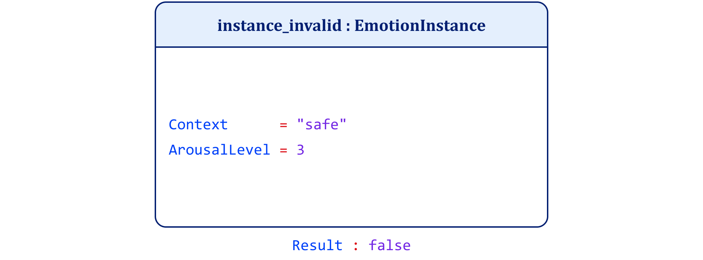

**Figure 9-6. Fear Instance (Invalid) UML Object Diagram**

Project 2 defends the bridge condition: a feeling may be real, identifiable, and context-bound without yet carrying emotional meaning. Figure 9-7 shows that a FeelingState may support EmotionalMeaning but does not automatically become it.

The implementation defines a feeling state through context and arousal. As Figure 9-8 shows, these properties establish semiotic availability. Emotional meaning appears only when the program invokes interpretation.

The program accepts three runtime inputs: context, arousal level, and mode. The mode controls whether the program stops at semiotic availability or proceeds to semantic achievement.

Input  

Output  

Input  

Output  

Nothing in the underlying feeling changes between the two outputs. Only interpretation differs. Feeling can function as sign-material without yet counting as an emotion.

**Figure 9-7. Feeling State–Emotional Meaning Bridge UML Class Diagram**

-----------------------------------------------------------------------------------------------------------------------------------------------------------  

**Figure 9-8. Feeling State (Before Interpretation) UML Object Diagram**

---------------------------------------------------------------------------------------------------------------------------------------------------------  

**Figure 9-9. Emotional Meaning UML Object Diagram**

------------------------------------------------------------------------------------------------------------------------------------------------------------  

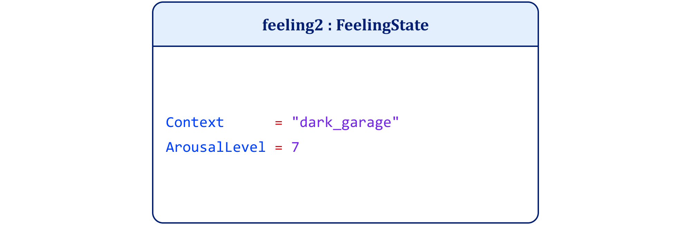

**Figure 9-10. Feeling State (Before Interpretation) UML Object Diagram**

--------------------------------------------------------------------------------------------------------------------------------------------------------  

Project 3 shows that the same feeling-in-context can yield different emotions under different goals. If bodily state alone determined emotion, a constant feeling would produce a constant emotion.

Figures 9-11 through 9-14 present the class structure for this demonstration. Figure 9-11 defines the FeelingState through context and arousal. Figure 9-12 defines the Goal as the governing constraint. Figure 9-13 defines EmotionInterpretation as the resulting emotional meaning. Figure 9-14 defines the Interpreter, which uses the feeling state and goal together to produce the interpretation.

Figures 9-15 through 9-18 show the concrete object executions. Figure 9-15 holds the feeling constant: the context remains backstage, and arousal remains 8. Figure 9-16 introduces the goal perform_well, which supports the interpretation shown in Figure 9-17: Excitement. Figure 9-18 then changes the goal to avoid_failure, and Figure 9-19 shows the resulting interpretation: Anxiety.

The program accepts three runtime inputs: context, arousal level, and goal.

Input  

Output  
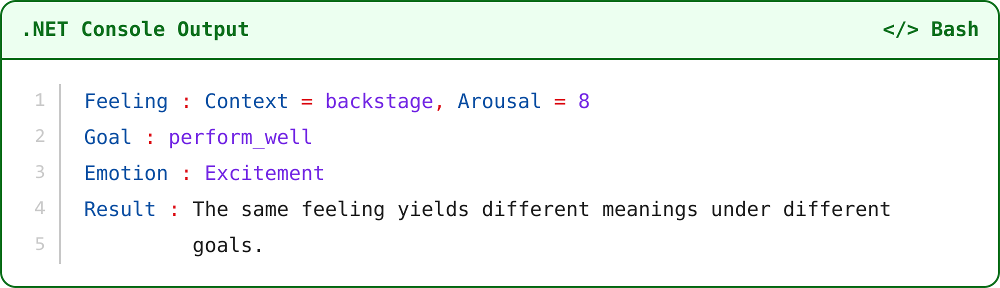

Input  

Output  

Only the goal changes between the runs. Yet the meaning shifts from excitement to anxiety. Meaning arises when an interpreter takes up a felt state under a governing aim.

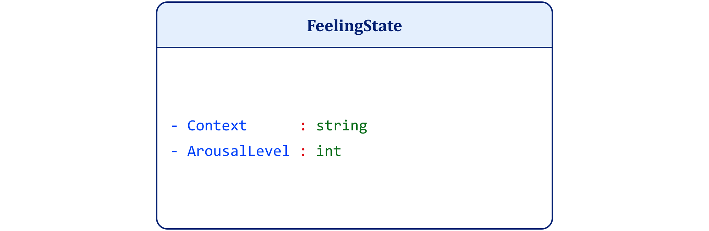

**Figure 9-11. Feeling State UML Class Diagram**

**Figure 9-12. Goal UML Class Diagram**

**Figure 9-13. Emotional Interpretation UML Class Diagram**

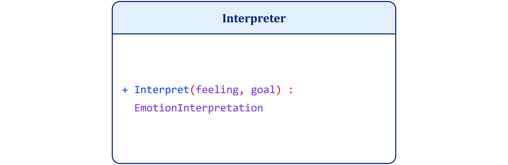

**Figure 9-14. Interpreter UML Class Diagram**

**Figure 9-15. Feeling State UML Object Diagram**

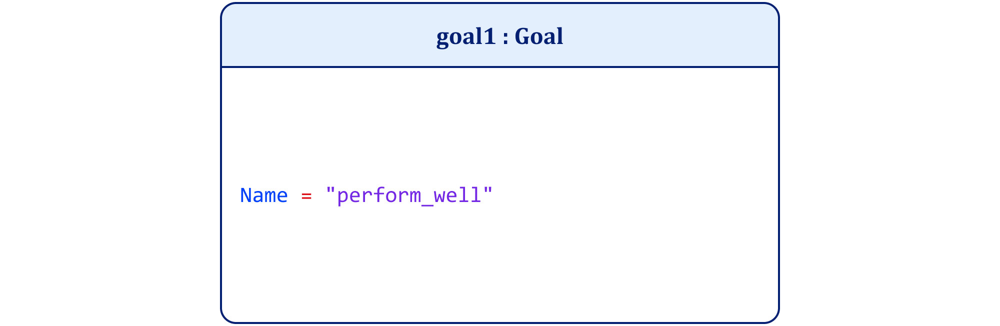

**Figure 9-16. Performance Goal UML Object Diagram**

**Figure 9-17. Excitement Interpretation UML Object Diagram**

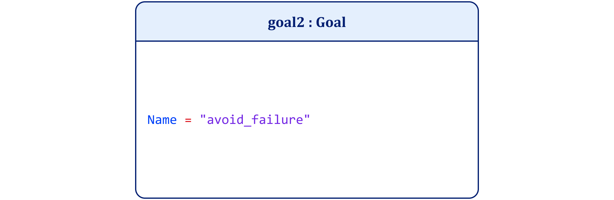

**Figure 9-18. Avoidance Goal UML Object Diagram**

**Figure 9-19. Anxiety Interpretation UML Object Diagram**

Project 4 illustrates the chapter’s claim that emotional meaning arises through an ordered sequence rather than a single undifferentiated event. Figures 9-20 through 9-23 present the class structure for that sequence. Figure 9-20 defines the external situation. Figure 9-21 defines the feeling state that the situation can produce. Figure 9-22 defines the goal that governs interpretation. Figure 9-23 defines emotional meaning as the result of interpretation. Figure 9-24 shows the pipeline that first converts situation into feeling, then interprets that feeling under a goal.

Figures 9-25 through 9-28 show the corresponding object-level execution. Figure 9-25 presents the external situation, footsteps_behind. Figure 9-26 shows the resulting feeling state: context dark_street, arousal level 7. Figure 9-27 introduces the goal stay_safe, and Figure 9-28 shows the resulting meaning, Fear. Figure 9-29 then shows the alternative meaning, Relief, when the interpretive context changes.

Input  

Output  
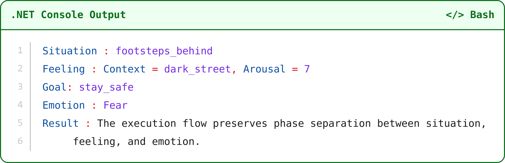

Input  

Output  

The external event does not contain emotional meaning. It first produces a feeling state, which becomes meaningful only under a governing goal. Causal sequence stays distinct from semantic achievement.

**Figure 9-20. External Situation UML Class Diagram**

**Figure 9-21. Feeling State UML Class Diagram**

**Figure 9-22. Goal UML Class Diagram**

**Figure 9-23. Emotional Meaning UML Class Diagram**

**Figure 9-24. Emotion Pipeline UML Class Diagram**

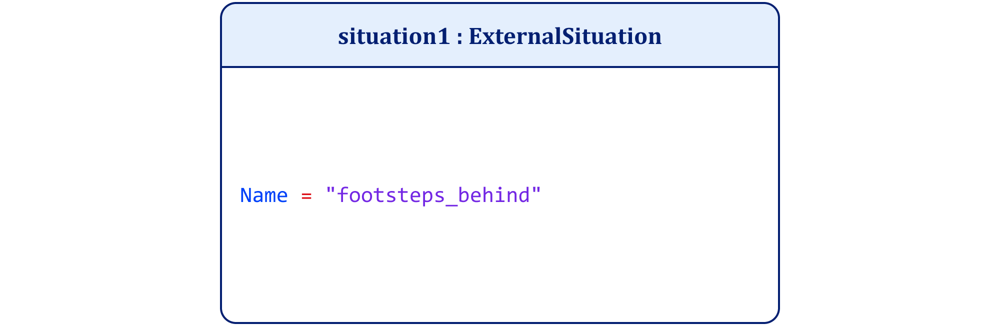

**Figure 9-25. External Situation UML Object Diagram**

**Figure 9-26. Feeling State UML Object Diagram**

**Figure 9-27. Safety Goal UML Object Diagram**

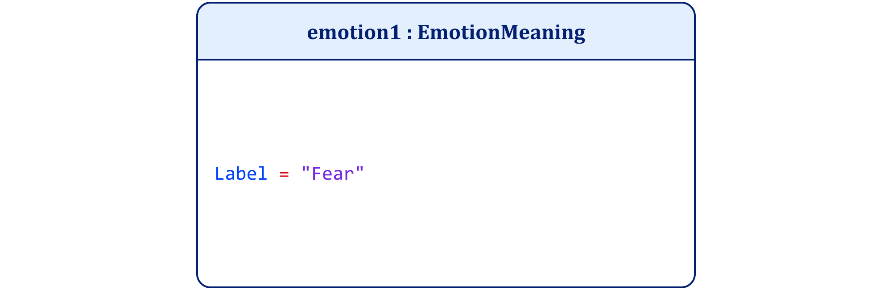

**Figure 9-28. Fear Meaning UML Object Diagram**

**Figure 9-29. Relief Meaning UML Object Diagram**

Project 5 isolates the chapter’s final executable claim: an agent can revise emotional meaning without changing the underlying feeling. Figures 9-30 through 9-32 define the class structure for that revision. Figure 9-30 defines the feeling state through context and arousal. Figure 9-31 defines the goal that continues to govern interpretation. Figure 9-32 defines emotional meaning as the interpretive result. Figure 9-33 defines the Reinterpreter, which takes the same feeling and goal together with updated contextual knowledge.

Figures 9-34 through 9-36 show the object-level execution. Figure 9-34 holds the feeling constant: context dark_street, arousal level 7. Figure 9-35 holds the goal constant: stay_safe. Figure 9-36 shows the initial interpretation, Fear, when the agent treats the other person as unknown. Figure 9-37 shows the revised interpretation, Relief, when the agent recognizes the other person as a friend.

Input  

Output  

Input  

Output  
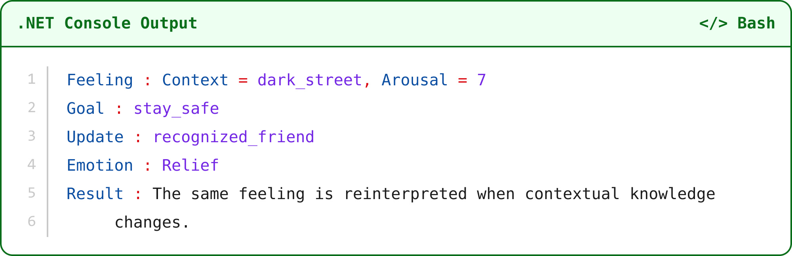

The feeling and the goal stay constant. Only contextual knowledge changes, and the meaning shifts from fear to relief. Because an agent constructs meaning, the agent can revise it when context warrants correction.

**Figure 9-30. Feeling State UML Class Diagram**

**Figure 9-31. Goal UML Class Diagram**

**Figure 9-32. Emotional Meaning UML Class Diagram**

**Figure 9-33. Reinterpreter UML Class Diagram**

**Figure 9-34. Feeling State (Stable) UML Object Diagram**

**Figure 9-35. Safety Goal (Stable) UML Object Diagram**

**Figure 9-36. Emotion Meaning (Initial Fear) UML Object Diagram**

**Figure 9-37. Emotion Meaning (Revised Relief) UML Object Diagram**

The five projects introduce no new claims. They enforce the claims already made.

Each isolates a failure point in contemporary emotion theory: identity, availability, governance, phase separation, and revisability.

Taken together, these projects do not merely illustrate the theory. They constrain it. Each executable forces a distinction that the architecture requires. If any distinction is removed, the code can no longer state the claim that depends on it. Identity dissolves into grouping. Availability collapses into meaning. The body is mistaken for the interpreter. Sequence collapses into simultaneity. Revision becomes impossible. The projects therefore work as executable specifications. They show what the model asserts and what breaks when its constraints are violated. They do not test the model against data; the programs encode its distinctions by design, so they establish internal consistency, not truth.

Affect remains causal. Feeling remains experiential. Emotion remains interpretive. The agent remains responsible.

Figure 9-38 integrates these constraints into a single, phase-ordered architecture.

**Figure 9-38. Metamorphosis of an Emotion**

Figure 9-38 separates simulation, bodily regulation, feeling, and interpretation so the reader can see where emotional meaning arises. Biological and predictive processes shape the field of possible interpretations but do not constitute meaning. Meaning emerges only when the agent performs an interpretive act that binds affect, concept, and governing goal.<a href="../references/notes/chapter-09.md#note-68">68</a>

The cognitive system performs regulation, prediction, and perception. Interpretation belongs to the agent.

**(1) External Situation (Exteroceptive Input).  
** The process begins with an external situation that impinges on the sensory systems. At this stage the stimulus is a physical configuration of the environment. It may trigger perceptual and physiological responses, but it possesses no intrinsic emotional meaning. The stimulus is therefore causally efficacious but semantically inert.

**(2) Predictive Simulation (Concept-Guided Anticipation).  
** The stimulus activates predictive simulation. The cognitive system anticipates possible outcomes by projecting concept-guided expectations about relevance, affordances, and potential consequences. This simulation narrows the range of plausible interpretations but remains pre-interpretive. It constrains the field within which an agent may later interpret the feeling, but it does not determine emotional meaning.<a href="../references/notes/chapter-09.md#note-69">69</a>

**(3) Cached Sign Structures (Memory Retrieval).  
** Predictive simulation draws upon cached sign structures stored in memory. Previously learned conceptual associations, cultural scripts, and past experiences supply the conceptual resources through which the situation may later be interpreted. They prepare the architecture of possible meanings but do not themselves produce emotional meaning.

**(4) Exteroceptive Perception (Sensory Confirmation).  
** Simultaneously, the organism organizes incoming sensory information through exteroceptive perception. Environmental features become structured into a coherent situational representation shaped by predictive expectations. Perception therefore delivers organized sensory input rather than evaluative meaning.<a href="../references/notes/chapter-09.md#note-70">70</a>

**(5) Interoceptive Signaling (Bodily State Registration).  
** At the same time the body generates interoceptive signals reflecting physiological changes within the organism. These signals communicate information about bodily condition such as heart rate, muscle tension, and metabolic readiness. Interoception supplies causal input to the system but does not yet constitute emotion.

**(6) Allostatic Activation (Non-Conscious Bodily Readiness).  
** The organism adjusts bodily resources through allostatic regulation in anticipation of potential demand. Energy allocation, arousal levels, and attentional readiness shift automatically as the system prepares for action. These changes influence the interpretive field by making certain responses more viable than others, yet they do not, in themselves, provide evaluative meaning.<a href="../references/notes/chapter-09.md#note-71">71</a>

**(7) Feeling (Metaperceived Awareness of Bodily State).  
** Interoceptive activity becomes consciously accessible through metaperception. Feeling arises as the conscious awareness of bodily condition within context, making the affective state available to the agent as potential sign-material for interpretation. Although this experience is real and experientially salient, no emotion yet exists at this stage. Feeling constitutes the experiential referent that later becomes available for interpretation.<a href="../references/notes/chapter-09.md#note-72">72</a>

Stages 8 and 9 represent a single interpretive act decomposed for clarity, not a temporal sequence. Stage 8 names the act; Stage 9 isolates its evaluative structure.

**(8) Emotion (Goal-Governed Interpretive Act).  
** Emotion arises when the agent performs a goal-governed interpretive act that assigns meaning to the felt state. At this point the agent binds the felt experience to an emotion concept under governing goals and contextual constraints. The cognitive system provides the enabling architecture that makes this act possible.

**(9) Interpretive Evaluation (Agent-Governed Judgment).  
** The interpretive act includes an evaluative judgment in which the agent determines how the felt state should be understood relative to goals and conceptual constraints. The judgment belongs to the agent.

**(10) Interpretive Delay (Cognitive Intervention Point).  
** The architecture permits interpretive delay. The agent may pause before finalizing interpretation, allowing reflective consideration of alternative conceptual bindings. This stage explains how agents can intervene in emotional interpretation rather than remaining locked into automatic responses.<a href="../references/notes/chapter-09.md#note-73">73</a>

**(11) Psychological Reappraisal (Intentional Reinterpretation).  
** Through deliberate reflection the agent may reinterpret the situation by revising contextual assumptions, conceptual framing, or governing goals. Reappraisal does not eliminate the underlying feeling but alters the meaning assigned to it.

**(12) Reinterpretation (Updated Emotional Meaning).  
** When reinterpretation occurs, the same bodily state may stabilize under a different emotional concept. In the diagram the initial interpretation of fear may be reconstructed as relief once new contextual information becomes available. Emotional meaning therefore proves revisable rather than fixed.

**(13) Updated External Situation (Revised Exteroceptive Context).  
**Finally, step 13 returns the process to the external situation. Changes in the environment do not retroactively alter earlier interpretations; they update the predictive and allostatic parameters that shape future ones. This is the architecture’s learning mechanism.

Taken together, the sequence demonstrates that emotions are neither reflexive bodily outputs nor automatic products of predictive categorization. Bodily signals and predictive simulations prepare the interpretive field, but emotional meaning arises only when the cognitive system stabilizes a semiotic sign that binds affect, concept, and goal. Emotion is therefore not detected but constructed through interpretive commitment within a goal-governed architecture of cognition.

I did not merely claim that emotions are constructed. I specified what an emotion must be to qualify as meaning, in an inspectable architecture.

I resolved the three structural failures that undermine most emotion theories.

First, I eliminated ontological collapse. Affect, feeling, and emotion do not form stages of a single process. They serve as non-substitutable roles with distinct identity conditions. Physiological affect belongs to the body as a causal substrate. Feeling belongs to consciousness as metaperceived interoception. Emotion belongs to interpretation as meaning achieved under constraint. With these roles fixed, sensation cannot masquerade as meaning. Regulation cannot masquerade as judgment.

Second, I secured the bridge condition. Semiotic availability does not equal semantic achievement. A feeling becomes eligible for meaning without becoming meaningful by default. It functions as sign-material situated in context, but it does not yet signify. Emotional meaning emerges only when an agent interprets that feeling under goal-relative constraints. Without this distinction, theories either smuggle meaning into sensation or dissolve meaning into mechanism.

Third, I restored interpretive governance. Emotional meaning does not function as an automatic output of appraisal loops or predictive simulations. It constitutes an agent-owned act governed by correctness conditions. Because goals and context constrain interpretation, emotions can succeed or fail. They can be justified or mistaken. They can be revised over time. Without this governed act, no emotional meaning exists. One finds only physiological change and behavioral consequence.

I demonstrated that these distinctions survive formal pressure. The CSME applies a unified semiotic architecture across both feeling and emotion while it preserves phase separation. The UML class diagram fixes the identity conditions of emotion concepts. The object diagram shows how an agent instantiates emotional meaning in context. The metamorphosis flow illustrates how prediction, perception, allostasis, and metaperception prepare the field without themselves constituting significance. No level collapses into another. No role performs the work of its neighbor.

The division of labor remains precise. Computation constrains and prepares. Interpretation constitutes meaning. Prediction biases salience. Allostasis shapes readiness. Simulation retrieves prior structures. None of these operations decides what a feeling signifies. They constrain the interpretive field, but only the agent determines the emotional meaning of the feeling through an act of interpretation. Meaning enters the architecture only when an agent interprets a semiotically available feeling relative to a governing goal.

The architecture now stands complete. An agent does not discover emotion. An agent constructs it under the law.

I have fixed emotional meaning as a constructed achievement rather than a discovered state. Now I face an unavoidable task. If emotions are signs, I must explain what makes signs possible in the first place. Emotional Constructivism rests on a macro-semiotic architecture, yet that architecture presupposes a deeper layer it has not yet justified. Interpretation requires symbolic material before it can produce meaning.

The next chapter moves downward. I shift from the macro-semiotic sign to its micro-semiotic constituents: how symbols make concepts possible, and why meaning collapses when that substrate is absent.

What follows is a formal account of how symbols enable concepts, how concepts participate in signs, and how signs yield intensional meaning.<a href="../references/notes/chapter-09.md#note-74">74</a> I show why perception can occur without symbols, but understanding cannot. I show why signals can exist without meaning, but signs cannot. Emotional meaning is only one instance of a more general semiotic achievement.

That is the task of [Chapter 10](../part-5/chapter-10.md), “All I Know Is What I Have Symbols For: The Linguistic Limits of Emotional Meaning.”
